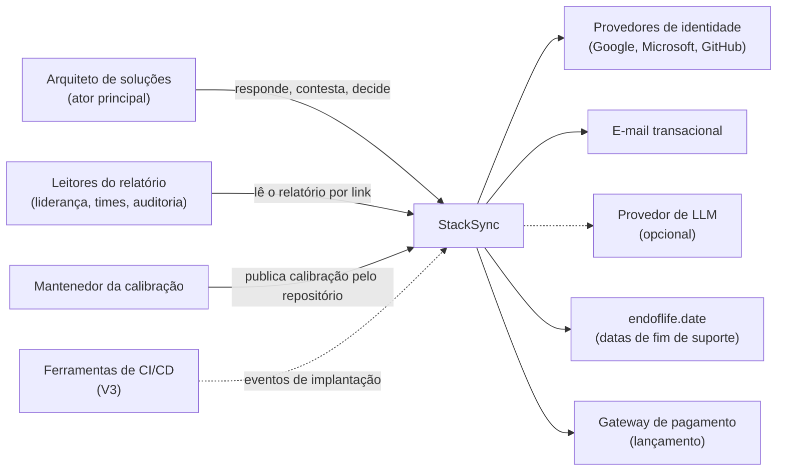
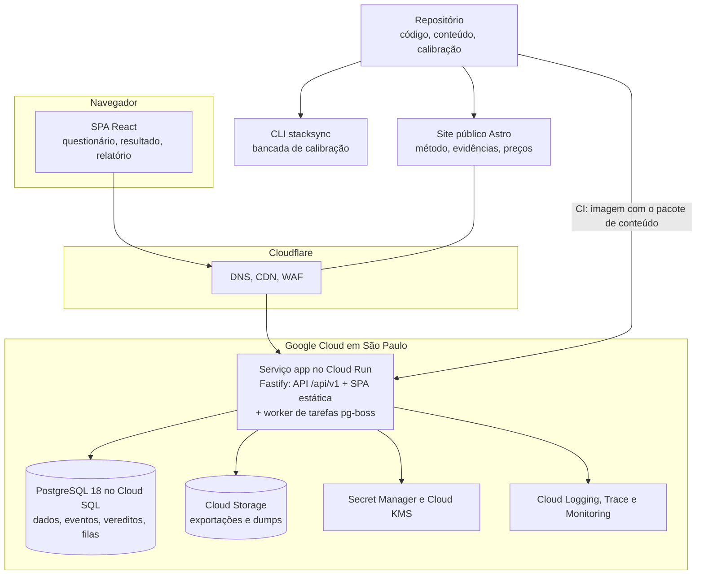
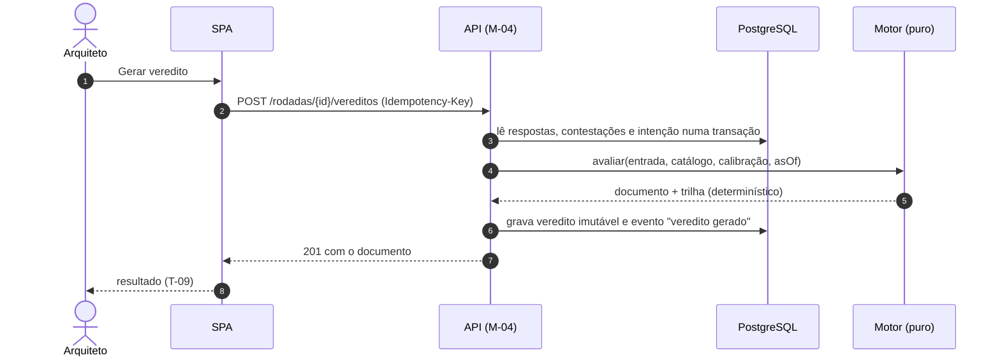
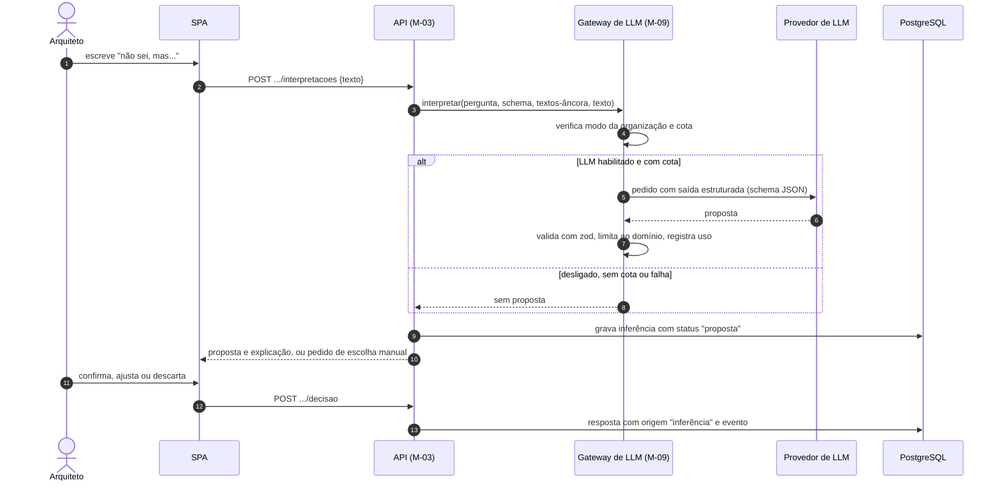
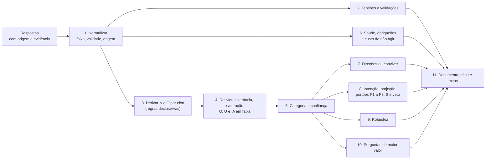
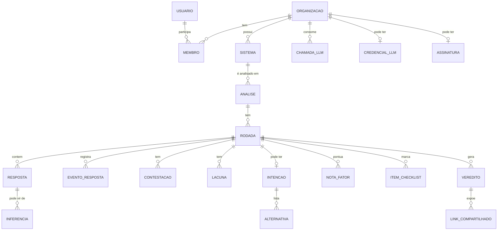
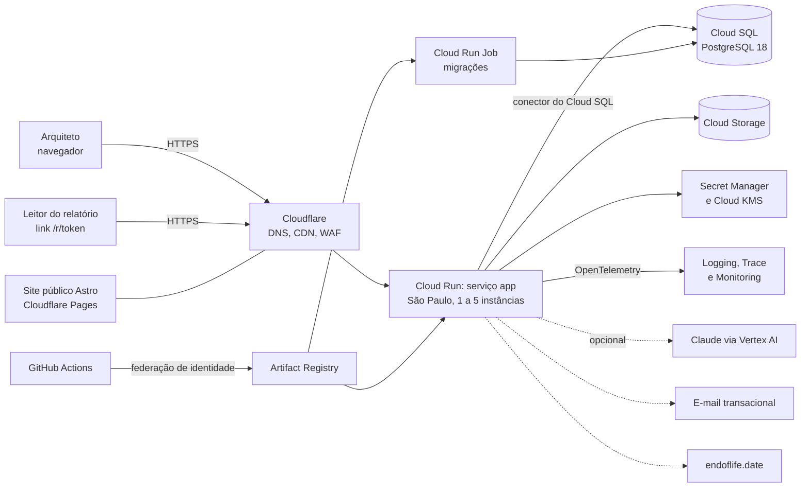

# StackSync — Parte 4: Arquitetura e planejamento técnico

Nov 7, 2026 · @Eduardo

Esta parte transforma as Partes 1 a 3 no plano técnico de construção do StackSync. Ela cobre os requisitos funcionais e não funcionais, a arquitetura, as tecnologias, o papel da inteligência artificial generativa, o modelo de custo e de cobrança, a segurança, a operação e a ordem de construção do projeto inteiro. As regras de negócio, as fórmulas e as telas da Parte 3 entram aqui como requisitos: nada nesta parte muda o que o StackSync decide, só como ele é construído. Onde a Parte 3 deixou o mecanismo em aberto ("como calcular é decisão da etapa técnica"), esta parte decide e marca o que ainda precisa ser validado na calibração.

**Método.** As decisões seguem o método que o próprio StackSync ensina. Os requisitos viram cenários de qualidade mensuráveis (UC-02), cada decisão compara alternativas, incluindo a mais simples (UC-04), e pesa as forças que separam e as que juntam (UC-06). O custo de distribuir (UC-07) e a reversibilidade (UC-12) entram na conta, e cada decisão fica registrada como ADR (UC-16). A seção 6 aplica os 8 eixos de ajuste ao próprio StackSync. Se a arquitetura escolhida não passasse no método que o produto vende, o produto perderia credibilidade.

## Como ler este documento

| Leitor | O que procurar | Seções principais |
| --- | --- | --- |
| Quem vai programar | Módulos, motor, dados, API, front-end, testes, repositório e plano por fase | 7, 9, 11, 12, 13, 16, 17, 18 |
| Quem decide produto e negócio | Papel da inteligência artificial generativa, custos, modelo de cobrança e prazos | 1, 10, 15.6, 18 |
| Quem revisa arquitetura e segurança | Requisitos, cenários de qualidade, decisões, segurança, riscos e o que foi descartado | 3, 4, 5, 6, 8, 14, 19, 20 |

**Convenções.**

- **IA** continua significando **Índice de Ajuste**, como na Parte 3. Modelos de linguagem são chamados de **LLM** ou de **inteligência artificial generativa**, sempre por extenso.
- **IDs desta parte:** RF (requisito funcional), QA (cenário de qualidade, isto é, requisito não funcional mensurável), AP (princípio de arquitetura), DT (decisão técnica, que vira um ADR no repositório), DC (decisão de cálculo do motor), M (módulo), FF (fitness function), F (fase do plano), R (risco técnico), PROP (propriedade testada do motor) e Q (questão em aberto). Os IDs das Partes 1 a 3 (UC, RN, T, K, V, TS, P, E, H) são usados sem alteração. Como na Parte 3, C-nn aparece tanto para perguntas do bloco C quanto para componentes de interface (P3 12.5); o contexto indica qual, e esta parte escreve "componente C-05" quando há risco de confusão. P1 a P8 são portões, e P-nn são casos de piloto.
- **Porta de mão única e porta de duas mãos.** Como na Parte 1 (RN-49), toda decisão é marcada como irreversível na prática (mão única) ou barata de desfazer (duas mãos). As de mão única recebem análise formal; as de duas mãos são tomadas rápido e ficam atrás de uma interface.
- **Versões e datas** valem para novembro de 2026 e precisam ser reconfirmadas no início de cada fase. É a mesma regra que o StackSync aplica ao arquiteto em F-12: sugestão com fonte, confirmada por quem decide.
- **Custos** são ordem de grandeza, para orientar decisões, e não orçamento.

## 1. Resumo executivo

- **Monólito modular, um artefato.** O StackSync é um monólito modular em TypeScript, com um único artefato implantável (API, tarefas em segundo plano e front-end estático) sobre um PostgreSQL. Com uma pessoa desenvolvendo e menos de 30 requisições por segundo no pico do primeiro ano, qualquer distribuição seria sobreajuste, e o próprio StackSync a classificaria assim (seção 6).
- **O coração é um motor determinístico.** O cálculo da Parte 3 vira um pacote puro, sem I/O, com aritmética de intervalos, trilha embutida e reprodutibilidade byte a byte. Ele é verificado contra os exemplos da Parte 3, casos-âncora, testes de propriedade e testes de mutação. A assertividade do produto inteiro depende desse pacote, e por isso ele recebe a maior parte do rigor.
- **Conhecimento como código.** Catálogo de perguntas, perguntas-ponte, regras de derivação, textos, calibração e casos-âncora ficam versionados como dados validados por schema. A RN-88 ("calibração só é publicada sem piorar o falso alarme") vira um portão automático de CI, e nenhuma mudança de calibração exige alterar código.
- **Sem inteligência artificial generativa no cálculo nem nos pesos.** LLMs não são reproduzíveis, não são calibráveis contra casos-âncora e tendem a entregar propostas, que é o viés de ação que o StackSync combate. O LLM entra em só dois pontos periféricos: interpretar o "não sei, mas..." e propor níveis a partir da descrição livre da mudança (G-03/G-04). Nos dois casos ele só propõe, e a proposta só vale depois de confirmada (RN-79). O produto funciona 100% com o LLM desligado.
- **Aprendizado de máquina nos pesos fica para depois.** Hoje existem cerca de 14 casos-âncora para dezenas de parâmetros, então qualquer ajuste estatístico decoraria os casos. A calibração continua com especialistas e evidência. Um otimizador assistido, que só sugere, entra quando houver pelo menos 50 casos reais com desfecho conhecido (seção 10.9).
- **O custo de LLM é desprezível, então não se vendem tokens.** Uma interpretação custa cerca de US$ 0,0007 no modelo pequeno, o que dá centavos de dólar por usuário por mês. Vender "poder de computação" não corresponde ao valor entregue e ainda penalizaria quem mais precisa do "não sei". A recomendação é cobrar pelo valor do produto, com o LLM incluso numa franquia de uso justo, e oferecer chave própria (BYOK) como opção de governança para empresas. A arquitetura suporta quatro modos (incluso, BYOK, créditos e desligado) por configuração, então dá para começar de um jeito e mudar depois sem refatorar (seção 10.7).
- **Sem WebSockets.** O ator é único e o cálculo leva menos de 0,5 s, então HTTP comum resolve. Tarefas longas usam Server-Sent Events (SSE). Webhooks de entrada chegam no lançamento (pagamento) e na V3 (CI/CD); webhooks de saída, só na V3.
- **Dados no Brasil.** A hospedagem fica no Google Cloud em São Paulo (Cloud Run e Cloud SQL), atrás da Cloudflare, com LGPD desde o desenho e isolamento por organização com row-level security. O único conteúdo de análise que sai do país é o texto enviado ao LLM opcional, e só depois de a organização permitir no primeiro uso.
- **Stack principal:** Node.js 26 LTS, Fastify, React com Vite, TanStack, PostgreSQL 18, Drizzle, pg-boss, Better Auth, OpenTofu, pnpm 11 com quarentena de versões novas e OpenTelemetry.
- **Validar o método antes da interface.** A Fase 1 entrega o motor, uma CLI e os casos-âncora, sem nenhuma tela. O app só começa quando o motor reproduz os exemplos da Parte 3 e cumpre as metas iniciais de falso alarme. Errar regras numa CLI custa dias; errar depois de 20 telas prontas custa meses.
- **Prazo estimado, em faixa, para uma pessoa em tempo integral:** 3,5 a 5,5 meses até o início do beta fechado e 6 a 10 meses até o lançamento comercial. A confiança dessa estimativa é baixa, e ela deve ser recalibrada com o tempo real de cada fase (falácia do planejamento, RN-48).
- **29 decisões técnicas registradas.** Cada uma tem as alternativas consideradas, a justificativa, o tipo de porta e a condição que a reabriria (seção 8).

## 2. Ponto de partida: o que as Partes 1 a 3 exigem da tecnologia

As características abaixo, tiradas das Partes 1 a 3, são as que moldam a arquitetura. A coluna da direita é a consequência técnica de cada uma.

| Característica do problema | Origem | Implicação técnica |
| --- | --- | --- |
| O produto é um cálculo explicável, não um cadastro | P3 seções 6.4 e 9 | Motor puro como núcleo; trilha tratada como dado de primeira classe |
| Números e regras mudam com a calibração, sem mudar o produto | P3 seção 11; RN-56, RN-82, RN-88 | Conteúdo separado do código, versionado e com regressão automática |
| Todo veredito precisa ser reproduzível e comparável entre versões | RN-82; 11.5; T-19 | Vereditos imutáveis, com versões de motor, catálogo e calibração e com a data de referência como entrada |
| Alterações feitas depois do veredito precisam ficar registradas | RN-81 | Eventos de resposta só por acréscimo (append-only) |
| Incerteza é dado, não exceção | 8.2; 9.3; RN-77 | Intervalos em todo o cálculo; origem e evidência em cada resposta |
| O "não sei, mas..." exige interpretar texto livre | 8.3; RN-79 | É o único ponto em que linguagem natural precisa virar estrutura, daí o LLM opcional com confirmação |
| Ator único, sessões de 15 a 25 minutos, baixo volume | P2; D-09; 8.1 | Sem colaboração em tempo real; sem escala massiva |
| Os dados descrevem arquiteturas, incidentes, custos e vulnerabilidades de empresas | Blocos D e F | Confidencialidade alta; isolamento por organização; dados no Brasil |
| O resultado vai para liderança e auditoria | T-18; RN-63 | Relatório imprimível e exportável; link de leitura com expiração |
| O StackSync não recomenda tecnologia nem favorece estilos | PR-06, PR-07, RN-83 | Textos do resultado só por modelos (templates) com lint de vocabulário; nada de texto gerado livremente |
| No futuro haverá medições importadas, times e execução | P3 seção 13 | Origem "medida" com fonte; modelo multi-organização desde o início; API com contrato público |

**O que fica fora.** O StackSync não analisa código (P3 3.4), não tem colaboração simultânea no MVP e não precisa de escala global. Toda tecnologia que só se justificaria por esses três motivos foi descartada (seção 19).

## 3. Requisitos funcionais

Os requisitos derivam das telas (T), dos casos de uso (UC) e das regras (RN) das Partes 2 e 3. A coluna Fase segue a seção 13 da Parte 3: **MVP**, **MVP-i** (interno), **V2**, **V3**, **L** (necessário para o lançamento comercial) e **Futuro**. A coluna Módulo aponta para a seção 7.3.

### 3.1 Identidade e organização

| ID | Requisito | Origem | Fase | Módulo |
| --- | --- | --- | --- | --- |
| RF-01 | Entrar sem senha, por link enviado por e-mail, ou com conta Google, Microsoft ou GitHub; passkey e segundo fator opcionais | 14.2 | MVP | M-01 |
| RF-02 | Toda conta nasce com uma organização pessoal; todo dado pertence a uma organização | D-09; P3 13 (times no futuro) | MVP | M-01 |
| RF-03 | Convidar membros com os papéis dono, arquiteto e leitor | P3 13 | V2 | M-01 |
| RF-04 | Exportar todos os dados da organização (JSON e relatórios) e excluir a conta | LGPD | MVP | M-01 |

### 3.2 Análises e questionário

| ID | Requisito | Origem | Fase | Módulo |
| --- | --- | --- | --- | --- |
| RF-05 | Criar análise com A-01 a A-05; trocar entre modo rápido e completo a qualquer momento, sem perder respostas | T-02; D-10; 8.1 | MVP | M-02 |
| RF-06 | Painel com estado, último veredito (categoria e faixa), confiança, versão da calibração, aviso de nova calibração e obrigação mais próxima; ordenação por atividade recente; duplicar como nova rodada; arquivar | T-01 | MVP | M-02 |
| RF-07 | Questionário gerado a partir do catálogo versionado (blocos A a G, modos E e C), com navegação livre e completude e confiança por bloco, sem nenhuma pista de direção do veredito | T-04; RN-81 | MVP | M-02 |
| RF-08 | Cartão de pergunta com os tipos de resposta da Parte 3 (opção, número, faixa, data, lista, texto, formulário guiado); seletor de origem com o mesmo destaque visual para todas as origens; fonte e data para medida; mínimo e máximo para estimativa; evidência opcional; selo do que a pergunta alimenta | T-05; 8.2 | MVP | M-02 |
| RF-09 | Salvamento contínuo, sem botão de salvar, com proteção contra perda e contra edição concorrente | T-04 | MVP | M-02 |
| RF-10 | Medidas com mais de K-13 meses passam a "antigas" e contam como estimativa; medida sem fonte conta como estimativa | 8.2 | MVP | M-04 |
| RF-11 | Respostas derivadas (E-04 a partir de D-01 e E-01) e "não se aplica" automático para sistema de parte única, com explicação | 12.7; 15 | MVP | M-02, M-04 |
| RF-12 | Validações V-01 a V-15, com a rigidez da calibração vigente, em tom informativo | 8.6; 11.2 | MVP | M-04 |
| RF-13 | Tensões TS-01 a TS-08, sem bloqueio, com confirmação justificada ("as duas estão corretas porque...") | 8.7 | MVP | M-04 |
| RF-14 | Fluxo "não sei" com até quatro perguntas-ponte curadas (um nível só), conversão determinística em faixa com explicação, e as opções aceitar, ajustar ou descartar | T-06; RN-79; RN-80 | MVP | M-03 |
| RF-15 | Campo "não sei, mas...": proposta de interpretação feita pelo LLM, se habilitado, que só vale depois de confirmada; o texto original fica na trilha; sem LLM, o arquiteto escolhe a faixa vendo os textos-âncora | 8.3; RN-79 | MVP | M-03, M-09 |
| RF-16 | Lacunas com "como descobrir" e "quem pode saber"; plano de descoberta com estados e exportação | T-17; RN-80 | MVP | M-03 |
| RF-17 | Sugestão de data de fim de suporte a partir de base de referência, com fonte e data da consulta, sempre confirmada pelo arquiteto | F-12; P3 questão 4 | MVP | M-10 |
| RF-18 | Revisão antes do veredito: composição das respostas, inferências a confirmar, tensões, lacunas que podem mudar o resultado e fatores de peso 5 desconhecidos | T-08 | MVP | M-02 |

### 3.3 Motor de decisão

| ID | Requisito | Origem | Fase | Módulo |
| --- | --- | --- | --- | --- |
| RF-19 | Gerar o veredito a qualquer momento, inclusive com respostas incompletas | RN-78 | MVP | M-04 |
| RF-20 | Derivar necessidade e capacidade por eixo, em faixa, com a trilha dos sinais | 9.2 | MVP | M-04 |
| RF-21 | Calcular O, U e IA em faixa, com tolerância, saturação e verificação quantitativa de E3 e E4 | 9.3 | MVP | M-04 |
| RF-22 | Classificar a categoria, a confiança e o modificador "conviver" | 9.4 | MVP | M-04 |
| RF-23 | Avaliar os indicadores H1 a H6, as obrigações datadas e o custo de não agir | 9.5 | MVP | M-04 |
| RF-24 | Gerar direções de ajuste só quando as três condições da 9.6 valem, na ordem dos pré-requisitos | 9.6; RN-75; RN-83 | MVP | M-04 |
| RF-25 | Calcular a robustez (variação de pesos, tolerâncias, limiares e respostas) e nomear o parâmetro e a resposta mais sensíveis | 9.9 | MVP | M-04 |
| RF-26 | Ranquear as perguntas de maior valor e marcar as que "podem pular" | 9.10 | MVP | M-04 |
| RF-27 | Gerar "o que mudaria este veredito" e "considerado e descartado" | 10.3 | MVP | M-04 |
| RF-28 | Selecionar até três razões principais, com evidência | 10.3 | MVP | M-04 |
| RF-29 | Produzir os textos do resultado só por modelos de texto com vocabulário fixo, sem texto gerado livremente | 10.1; 10.4; 12.6 | MVP | M-04 |
| RF-30 | Contestar um nível com justificativa e mostrar os dois cálculos lado a lado | RN-86; T-10 | MVP | M-04 |
| RF-31 | Nunca exibir veredito parcial durante o preenchimento; registrar e mostrar as alterações feitas depois do veredito | RN-81 | MVP | M-02 |
| RF-32 | Persistir o veredito como documento imutável, com versões e hash das entradas; recalcular sob nova calibração e mostrar a diferença | 11.5; RN-82 | MVP (recálculo na V2) | M-04, M-05 |

### 3.4 Intenção de refatoração e decisão

| ID | Requisito | Origem | Fase | Módulo |
| --- | --- | --- | --- | --- |
| RF-33 | Bloco G em etapas, com alternativas obrigatórias automáticas, sugestões das regras, ordem neutra e preferência bloqueada até todas as alternativas estarem descritas | T-07; V-04; V-07; V-11 | MVP | M-06 |
| RF-34 | Projeção de níveis por alternativa: proposta (catálogo de movimentos e LLM opcional) e confirmação com os textos-âncora à vista | G-04 | MVP | M-06, M-09 |
| RF-35 | Esteira de portões P1 a P8, com limite desfavorável e critério de invasividade | 9.7 | MVP | M-04 |
| RF-36 | Matriz dos 16 fatores: nota sugerida em faixa, nota do arquiteto com justificativa, índice S em faixa, veto e regra dos pesos baixos | T-14; 9.8 | MVP | M-06 |
| RF-37 | Checklist go/no-go com evidência por item; aprovação habilitada só com os itens 1 a 12 e sem veto | T-15 | MVP | M-06 |
| RF-38 | Máquina de estados da proposta (Rascunho, Enquadrada, Analisada, Aprovada, Não aprovada, Arquivada, Em execução, Concluída) | P2, convenções | MVP | M-06 |
| RF-39 | Comparador de alternativas com marca "dominada" | T-13 | V2 | M-06 |
| RF-40 | ADR gerado e editável, com status e ligação a ADRs anteriores; exportação em Markdown no formato MADR | T-16; RN-63 | V2 | M-07 |

### 3.5 Resultado, relatório e transparência

| ID | Requisito | Origem | Fase | Módulo |
| --- | --- | --- | --- | --- |
| RF-41 | Tela de resultado com os 15 componentes e todas as variantes | T-09; 10.3 | MVP | Web |
| RF-42 | Detalhe de eixo ou indicador com sinais, sensibilidade e contestação | T-10 | MVP | Web, M-04 |
| RF-43 | Trilha de raciocínio navegável, com filtros e exportação | T-11 | MVP | Web, M-07 |
| RF-44 | Relatório para liderança com página principal e apêndice; versão de impressão, Markdown e link de leitura com expiração e revogação | T-18 | MVP (PDF gerado no servidor na V2) | M-07 |
| RF-45 | "Como o StackSync decide" gerado a partir do conteúdo vigente | T-03 | MVP | Web |
| RF-46 | Biblioteca de evidências | T-21 | V2 | Web |
| RF-47 | Histórico com diferenças entre rodadas | T-19 | V2 (o registro de alterações é MVP) | M-05 |

### 3.6 Calibração

| ID | Requisito | Origem | Fase | Módulo |
| --- | --- | --- | --- | --- |
| RF-48 | Calibração versionada no repositório; a bancada roda os casos-âncora, compara as métricas e bloqueia a publicação que piore o falso alarme | UC-22; T-22; RN-88 | MVP-i | M-08, CLI |
| RF-49 | Calibração local (pesos e materialidade) com justificativa, sempre ao lado do veredito padrão | 11.4 | V2 | M-08 |
| RF-50 | Aviso de nova calibração e recálculo opcional | 11.5 | V2 | M-08 |

### 3.7 Execução e medição

| ID | Requisito | Origem | Fase | Módulo |
| --- | --- | --- | --- | --- |
| RF-51 | Plano de execução com fatias, técnica, ponto de reversão, fitness functions e gates | T-20; UC-17 | V3 | M-06 |
| RF-52 | Medições por fatia contra a linha de base e o fluxo "Piorou? Reavaliar" | UC-19 | V3 | M-06 |
| RF-53 | Importar medições (implantações e falhas) de ferramentas de CI/CD como origem "medida", com fonte | P3 3.4 e 13 | V3 | M-10 |

### 3.8 Plataforma e negócio

| ID | Requisito | Origem | Fase | Módulo |
| --- | --- | --- | --- | --- |
| RF-54 | Planos, direitos de uso (entitlements) e cotas por organização | Seção 10 | L | M-11 |
| RF-55 | Assinatura recorrente com Pix, boleto e cartão, e emissão de nota fiscal de serviço | Seção 10.8 | L | M-11 |
| RF-56 | Modo de LLM por organização: incluso, chave própria (BYOK) ou desligado | Seção 10.7 | MVP (incluso e desligado); V2 (BYOK) | M-09 |
| RF-57 | E-mails transacionais (acesso, convite, nova calibração); lembretes das condições de "o que mudaria" | P3 13 | MVP (lembretes: Futuro) | M-12 |
| RF-58 | Métricas de produto da seção 14 da Parte 3, calculadas internamente e sem conteúdo de respostas | P3 14 | MVP | M-13 |
| RF-59 | Acesso de suporte ao conteúdo de uma análise só com consentimento explícito da organização, temporário e registrado | Seção 14 | L | M-01 |

## 4. Requisitos não funcionais

### 4.1 Premissas de volume

Os números abaixo dimensionam a infraestrutura. São hipóteses, mas a margem de erro tolerada é grande: mesmo dez vezes mais carga continuaria cabendo na arquitetura escolhida.

| Grandeza | Beta fechado | Primeiro ano | Base |
| --- | --- | --- | --- |
| Organizações ativas | 10 a 30 | 300 a 2.000 | Hipótese de produto |
| Análises por usuário ativo por mês | 2 a 4 | 2 a 4 | Sessões de 15 a 25 minutos (P3 8.1) |
| Respostas por análise | cerca de 40 (rápido) a 130 (completo) | igual | Catálogo da Parte 3 |
| Eventos de resposta por análise | 100 a 400 | igual | Salvamento por pergunta, não por tecla |
| Tamanho do documento de veredito | 50 a 300 KB de JSON com trilha | igual | Estimativa |
| Requisições por segundo no pico | menos de 5 | menos de 30 | Ator único, uso em horário comercial |
| Banco de dados em 12 meses | menos de 2 GB | menos de 20 GB | Vereditos guardados por inteiro |
| Chamadas de LLM por análise | 0 a 20 | igual | Uso de "não sei, mas..." e de G-04 |

**Conclusão de dimensionamento.** Uma instância modesta de PostgreSQL e uma instância de aplicação atendem com folga. Escalabilidade não é onde está o risco deste projeto. O risco está na correção do motor e na calibração (seção 4.3).

### 4.2 Cenários de qualidade

Os cenários percorrem as 9 características da ISO/IEC 25010:2023 (RN-08), no formato estímulo, resposta e medida (UC-02).

| ID | Característica | Cenário | Medida |
| --- | --- | --- | --- |
| QA-01 | Adequação funcional (correção) | Um veredito guardado é recalculado com as mesmas entradas e as mesmas versões de motor, catálogo e calibração | Documento idêntico (mesmo hash) em 100% dos casos, em qualquer máquina e versão do runtime suportada |
| QA-02 | Adequação funcional (correção) | O motor é comparado com a especificação da Parte 3 | Exemplos da Parte 3 reproduzidos (ex.: Exemplo B com IA 50 e disponibilidade composta de 99,70%); invariantes da seção 9.10 sem violação; escore de mutação do motor de pelo menos 80% |
| QA-03 | Adequação funcional (fidelidade) | Uma versão candidata de calibração roda nos casos-âncora | Falso alarme até 5%, omissão até 10% e concordância de categoria de pelo menos 85% (metas da P3 11.3); publicação bloqueada se o falso alarme piorar |
| QA-04 | Adequação funcional (transparência) | O arquiteto abre a origem de qualquer número do resultado | 100% dos números exibidos têm nó de trilha com entradas, regra e evidência (teste automático) |
| QA-05 | Eficiência de desempenho | O arquiteto pede o veredito completo (com robustez, valor da informação e portões) de uma análise com 130 respostas | p95 de até 500 ms no servidor |
| QA-06 | Eficiência de desempenho | O arquiteto responde uma pergunta | Salvamento com p95 de até 200 ms a partir de São Paulo; nenhuma resposta perdida em queda de conexão |
| QA-07 | Eficiência de desempenho | Primeiro acesso ao app numa rede 4G | Maior elemento visível (LCP) em até 2,5 s; JavaScript inicial de até 200 KB comprimido |
| QA-08 | Compatibilidade | Uma versão nova da API ou do documento de veredito é publicada | Nenhuma quebra de contrato sem nova versão (verificação automática do contrato OpenAPI e do schema do documento); Lei de Hyrum (RN-67) |
| QA-09 | Compatibilidade | O arquiteto leva o resultado para outra ferramenta | Exportações em formatos abertos (Markdown, JSON com schema publicado e PDF) |
| QA-10 | Capacidade de interação | Um arquiteto que nunca usou o StackSync faz um diagnóstico rápido | Primeiro veredito entre 15 e 25 minutos (hipótese da P3, medida no beta) |
| QA-11 | Capacidade de interação (acessibilidade) | Uma pessoa usa só o teclado ou um leitor de tela | WCAG 2.2 nível AA; questionário completo por teclado; categorias e status identificáveis sem depender de cor; nenhuma violação séria ou crítica do axe nas jornadas J1 a J4 |
| QA-12 | Confiabilidade | Falha de zona ou de instância em horário comercial | Disponibilidade mensal de pelo menos 99,5%; perda máxima de dados (RPO) de 5 minutos; restauração (RTO) em até 4 horas, ensaiada todo trimestre |
| QA-13 | Confiabilidade | Um webhook ou uma tarefa em segundo plano é entregue duas vezes | O efeito acontece uma vez só (idempotência); nenhuma tarefa perdida sem alarme |
| QA-14 | Segurança (confidencialidade) | Usuário de uma organização tenta acessar dado de outra, por qualquer rota | Zero acessos; teste automático em todas as rotas e row-level security forçada no banco |
| QA-15 | Segurança | Uma chave de LLM própria (BYOK) é cadastrada | Nunca aparece em log, resposta de API ou backup em claro; cifrada com KMS; rotacionável |
| QA-16 | Segurança (cadeia de suprimentos) | Uma dependência é publicada comprometida no npm | Não entra no build antes da quarentena; SBOM em todo release; vulnerabilidade crítica conhecida corrigida em até 7 dias |
| QA-17 | Segurança (privacidade) | Conteúdo de uma análise circula pelo sistema | Nunca vai para analytics nem para logs; só sai do Brasil no envio ao LLM, depois do aviso de primeiro uso e se a organização permitir |
| QA-18 | Manutenibilidade | O mantenedor muda um peso, um limiar ou um texto | Nenhuma linha de código muda; do pull request à produção em menos de 1 dia, com o portão de casos-âncora |
| QA-19 | Manutenibilidade | Um módulo importa a parte interna de outro | O build falha (zero violações de fronteira) |
| QA-20 | Manutenibilidade | Uma pessoa nova sobe o ambiente local | Em menos de 15 minutos, com um comando e dados de exemplo |
| QA-21 | Flexibilidade | O modelo de cobrança do LLM muda (incluso, BYOK, créditos, desligado) ou o provedor muda | Só configuração e adaptador; nenhum código de domínio ou do motor alterado |
| QA-22 | Flexibilidade (portabilidade) | A empresa decide trocar de nuvem | Só serviços com equivalente padrão (contêiner, PostgreSQL, armazenamento compatível com S3); a troca exige reescrever só a infraestrutura como código e migrar dados |
| QA-23 | Flexibilidade | O LLM está fora do ar ou desligado | Todas as jornadas continuam possíveis (a suíte E2E roda com o adaptador nulo) |
| QA-24 | Proteção (*safety* da decisão) | Qualquer resultado é gerado | Nenhum texto recomenda tecnologia, produto ou fornecedor, usa linguagem de urgência ou condicional vago (lint dos modelos e teste da saída) |
| QA-25 | Proteção (*safety* da decisão) | O veredito é Ajustado | Zero direções de ajuste e zero textos de sugestão (teste de propriedade, RN-75) |

A característica *safety* da ISO/IEC 25010:2023 normalmente fala de dano físico. Aqui ela foi interpretada como o dano que o StackSync pode causar ao induzir uma decisão ruim, que é o risco real deste produto.

### 4.3 Árvore de utilidade

A árvore de utilidade do ATAM (RN-18) classifica cada cenário por importância para o negócio e por dificuldade técnica: alta (A), média (M) ou baixa (B).

| Atributo | Cenários (importância, dificuldade) |
| --- | --- |
| Correção e fidelidade | QA-02 (A, A) · QA-03 (A, A) · QA-01 (A, M) · QA-04 (A, M) |
| Usabilidade | QA-10 (A, A) · QA-11 (M, M) |
| Segurança e privacidade | QA-14 (A, M) · QA-17 (A, M) · QA-15 (A, B) · QA-16 (M, B) |
| Proteção da decisão | QA-24 (A, M) · QA-25 (A, B) |
| Manutenibilidade e flexibilidade | QA-18 (A, M) · QA-21 (A, B) · QA-23 (A, B) · QA-19 (M, B) · QA-20 (M, B) · QA-22 (M, M) |
| Confiabilidade | QA-12 (M, B) · QA-13 (M, M) |
| Desempenho | QA-05 (M, B) · QA-06 (M, B) · QA-07 (M, B) |

**Leitura.** Os três cenários (A, A) são a correção do motor (QA-02), a fidelidade da calibração (QA-03) e o tempo até o primeiro veredito (QA-10). Os dois primeiros justificam a Fase 1 antes de qualquer tela; o terceiro só se mede com usuários reais, e por isso o beta fechado é uma fase própria. Desempenho e escala aparecem como (M, B): investir neles agora seria otimizar onde não há risco.

### 4.4 Pontos de sensibilidade e de trade-off

| Tipo | Decisão | Efeito | Como foi resolvido |
| --- | --- | --- | --- |
| Sensibilidade | Aritmética de ponto flutuante no motor | Funções como `Math.pow` podem variar entre versões do runtime e quebrar a reprodutibilidade (QA-01) | Só operações básicas no motor (soma, subtração, multiplicação, divisão), potências por multiplicação repetida, arredondamento fixo na saída (DC-01) |
| Sensibilidade | Regras de derivação de nível (K-17) | Pequenas mudanças alteram muitos vereditos (QA-03) | Regras como dados, regressão com casos-âncora em todo pull request (FF-03) |
| Trade-off | Usar LLM no "não sei, mas..." | Melhora a usabilidade (QA-10), mas pesa na privacidade (QA-17), no custo e na reprodutibilidade | Só propõe; confirmação obrigatória; a faixa confirmada é a entrada reproduzível; pode ser desligado (QA-23) |
| Trade-off | Uma região só (São Paulo) | Residência dos dados, menor custo e simplicidade contra a disponibilidade (QA-12) | 99,5% aceito: a necessidade de resiliência do StackSync é nível 1 a 2 (seção 6) |
| Trade-off | Onde roda o motor | No servidor: integridade do registro (RN-81) e fonte única. No navegador: interatividade | O servidor é a fonte da verdade; o mesmo pacote roda no navegador só na bancada de calibração |
| Trade-off | Conteúdo no repositório ou em editor web | Repositório: revisão, diff e regressão. Editor web: autonomia de mantenedores que não programam | Repositório agora; editor web que abre pull requests quando existir mantenedor não técnico |
| Trade-off | Autenticação como biblioteca ou como serviço gerenciado | Biblioteca: dados no Brasil e sem custo por usuário. Serviço: menos responsabilidade de segurança | Biblioteca atrás de uma porta (DT-13), com risco de governança monitorado |

## 5. Princípios de arquitetura

| ID | Princípio | De onde vem | Como se verifica |
| --- | --- | --- | --- |
| AP-01 | Monólito modular primeiro: fronteiras internas fortes, um artefato implantável | P1 (MonolithFirst, Prime Video); RN-17; RN-21; Conway com uma pessoa | FF-01 (fronteiras); seção 6 |
| AP-02 | Núcleo puro, efeitos nas bordas (portas e adaptadores) | Cockburn (arquitetura hexagonal); QA-01; QA-21 | FF-02 (pureza do motor) |
| AP-03 | Conhecimento como código: catálogo, regras, textos e calibração versionados como dados | RN-56; RN-82; RN-88; QA-18 | FF-03, FF-07 |
| AP-04 | Imutabilidade onde a regra exige histórico: vereditos imutáveis e eventos de resposta só por acréscimo | RN-81; RN-82; T-19 | Gatilho no banco que impede alterar vereditos; FF-05 |
| AP-05 | LLM periférico, opcional e sempre confirmado | RN-79; PR-01; QA-23 | FF-13 (jornadas sem LLM) |
| AP-06 | Portas de mão única recebem análise formal; portas de duas mãos ficam atrás de interfaces | RN-49; carta da Amazon (2015) | Coluna "Porta" na seção 8 |
| AP-07 | Cada componente de infraestrutura precisa ser justificado por um cenário de qualidade | P1 (custo de distribuir); RN-25 | Revisão de ADR; seção 19 |
| AP-08 | Segurança e privacidade por padrão | LGPD; QA-14 a QA-17 | FF-08; seção 14 |
| AP-09 | Fitness functions protegem cada decisão estrutural a cada build | Ford, Parsons & Kua (2017); RN-69 | Seção 16.2 |
| AP-10 | Aplicar o método do StackSync ao próprio StackSync | Coerência e credibilidade | Seção 6; caso-âncora S-11 |

## 6. O StackSync aplicado a si mesmo

Antes de escolher tecnologia, a arquitetura-alvo foi passada pelos 8 eixos da Parte 3, com a calibração v0.1 (pesos E1 4, E2 5, E3 4, E4 3, E5 3, E6 5, E7 4, E8 2; tolerância 0,5, ou 1,0 para sobra em E7; E_max 2).

### 6.1 Eixos de ajuste

| Eixo | Necessidade | Capacidade proposta | Desvio | Leitura |
| --- | --- | --- | --- | --- |
| E1 Modularidade interna | 2,5: vários subdomínios com volatilidade diferente (o conteúdo de calibração muda toda semana, a cobrança quase nunca) e um núcleo cuja correção é crítica | 3: módulos com interfaces claras e regras automáticas de fronteira | +0,5 | Dentro da tolerância |
| E2 Distribuição | 0,5: uma pessoa; forças de juntar fortes (resposta, evento e veredito na mesma transação; o motor consome tudo); nenhum perfil de carga distinto | 1: um serviço principal mais o site público estático | +0,5 | Dentro da tolerância |
| E3 Comunicação e consistência | 1: tudo no mesmo processo; integrações pontuais (LLM, e-mail, pagamento, datas de fim de suporte) | 1: poucas chamadas externas síncronas com tempo-limite; webhooks idempotentes | 0 | Ajustado |
| E4 Escalabilidade e desempenho | 1: carga baixa, crescimento incerto | 1,5: escala horizontal automática do todo, fornecida pela plataforma sem custo extra | +0,5 | Dentro da tolerância |
| E5 Resiliência e disponibilidade | 1,5: indisponibilidade é incômoda, mas perder dados seria grave | 2: redundância gerenciada, restauração para um ponto no tempo, ensaio de restauração | +0,5 | Dentro da tolerância |
| E6 Alinhamento sociotécnico | 0: uma pessoa | 1: uma fronteira, com um dono | +1,0 | Sobra de 0,5 além da tolerância (ver 6.2) |
| E7 Sofisticação operacional | 1: uma parte, criticidade moderada | 2: implantação e provisionamento automatizados, monitoramento com alertas | +1,0 | Dentro da tolerância de sobra de E7 (1,0) |
| E8 Flexibilidade e extensibilidade | 2,5: alta incerteza sobre o modelo de cobrança, o provedor de LLM e as regras (valor de opção, RN-50) | 2,5: pontos de extensão exatamente nessas incertezas (portas de LLM, cobrança e identidade; regras como dados) | 0 | Ajustado |

**Conta.** Só E6 contribui: 5 × 0,5 = 2,5. O = 100 × 2,5 / (2 × 30) ≈ 4; U = 0; IA ≈ 96. **Veredito: Ajustado.** Qualquer uma das alternativas descartadas na seção 19 (microsserviços, Kubernetes, fila distribuída) empurraria E2, E6 e E7 para sobreajuste saturado.

### 6.2 Observação para a calibração

A autoaplicação revelou uma ambiguidade nos textos-âncora de E6. A capacidade 0 ("nenhuma fronteira de propriedade: todos mexem em tudo, ninguém é dono") descreve uma patologia, mas é o nível que a fórmula espera para a necessidade 0 ("uma pessoa ou dupla"). Para uma pessoa só, "uma fronteira com um dono" (capacidade 1) é o ajuste ideal, e mesmo assim gera um sobreajuste artificial de 0,5 nível. Duas correções possíveis entram no backlog da calibração da Fase 1: reescrever a âncora de capacidade 0 de E6 ("propriedade não formalizada, adequada a uma ou duas pessoas") ou fazer a necessidade 0 mapear para o ideal 1. Esta própria análise vira o caso-âncora **S-11** ("StackSync: uma pessoa, monólito modular, gabarito Ajustado").

### 6.3 Saúde e obrigações do próprio projeto

| Indicador | Situação esperada | Leitura |
| --- | --- | --- |
| H1 Juros da dívida | Saudável (projeto novo) | Medir hotspots a partir da Fase 3 |
| H2 Rede de segurança | Saudável no motor (propriedades, mutação, casos-âncora); atenção no front-end | Os testes concentram-se onde está o risco (QA-02) |
| H3 Dependências | Saudável, com quarentena e atualização semanal | DT-27 |
| H4 Ciclo de vida | Saudável: Node.js 26 com suporte até 30/04/2029; PostgreSQL 18 até novembro de 2030 | Plano anual de atualização (seção 15.7) |
| H5 Conhecimento e propriedade | **Crítico enquanto houver uma pessoa só** (fator ônibus 1) | Mitigado com ADRs, runbooks, infraestrutura como código e testes legíveis (R-03); não se resolve com tecnologia |
| H6 Desempenho de entrega | Meta: implantação diária, lead time abaixo de 1 dia, taxa de falha de mudança abaixo de 15% | Medido pelo próprio pipeline |

**Obrigações datadas da stack (novembro de 2026).** O Node.js 24 passou à manutenção em outubro de 2026 (fim em 30/04/2028), por isso a escolha do 26. O PostgreSQL 19 tem lançamento previsto para 19/11/2026: a adoção fica para depois de o serviço gerenciado suportá-lo e de saírem as primeiras correções. A partir do Node.js 27, o projeto passa a lançar uma versão por ano, todas LTS. Se um dia o StackSync for distribuído como software instalável na UE, entram as datas do Cyber Resilience Act (seção 14.5).

## 7. Visão de arquitetura

A visão segue os níveis do modelo C4: contexto, contêineres e componentes (módulos).

### 7.1 Contexto



O arquiteto continua sendo o único ator que opera a análise (D-09). Leitores só leem relatórios por link, e o mantenedor da calibração (UC-22) atua pelo repositório, não por uma tela de produção.

### 7.2 Contêineres



| Contêiner | Tecnologia | Responsabilidade | Observação |
| --- | --- | --- | --- |
| SPA | React 19, Vite, TanStack Router e Query | Todas as telas do produto | Servida pelo próprio serviço app, na mesma origem da API |
| Serviço app | Node.js 26, Fastify | API, entrega da SPA, tarefas em segundo plano | Um artefato; a variável `APP_ROLE` escolhe `api`, `worker` ou `all`. No MVP, um processo faz tudo |
| Banco | PostgreSQL 18 gerenciado | Dados transacionais, eventos, vereditos e filas de tarefas | Uma instância por ambiente |
| Armazenamento de objetos | Cloud Storage | Exportações (PDF na V2) e dumps lógicos | API compatível com S3 por interoperabilidade |
| Segredos | Secret Manager e Cloud KMS | Segredos da aplicação; cifragem das chaves de BYOK | Nenhum segredo em variável de ambiente versionada |
| Site público | Astro, estático | Método, calibração vigente, biblioteca de evidências, preços | Gerado do mesmo pacote de conteúdo; entra no lançamento |
| CLI | Node.js | Avaliar casos, explicar trilhas, rodar a bancada de calibração | Uso interno; mesma base do motor |

### 7.3 Módulos do monólito

Cada módulo tem três camadas: `domain` (tipos e regras puras), `application` (casos de uso e portas) e `adapters` (rotas HTTP, repositórios, clientes externos). Um módulo só usa outro pela interface pública (o `index.ts` do módulo) e nunca lê as tabelas de outro diretamente. Efeitos colaterais entre módulos, como notificar ou contar métricas depois de um veredito, saem como eventos de domínio gravados na mesma transação e entregues pela fila depois do commit.

| ID | Módulo | Responsabilidade | Dados que possui | Depende de |
| --- | --- | --- | --- | --- |
| M-01 | Identidade e organização | Contas, sessões, organizações, membros, papéis, exportação e exclusão | usuários, sessões, contas OAuth, organizações, membros | Plataforma |
| M-02 | Análises e questionário | Sistemas, análises, rodadas, respostas, eventos, revisão, painel | sistemas, análises, rodadas, respostas, eventos de resposta | M-01, conteúdo, M-03 |
| M-03 | Incerteza e descoberta | Perguntas-ponte, inferências, lacunas, plano de descoberta | inferências, lacunas | Conteúdo, M-09 (porta do interpretador) |
| M-04 | Veredito | Monta a entrada do motor, chama o motor, grava o documento imutável, contestações | vereditos, contestações | Motor, conteúdo, M-02 (leitura) |
| M-05 | Histórico | Diferenças entre rodadas, alterações depois do veredito, recálculo sob nova calibração | (lê M-02 e M-04) | M-02, M-04 |
| M-06 | Intenção e decisão | Bloco G, alternativas, projeção, matriz, checklist, estados da proposta; execução na V3 | intenções, alternativas, notas da matriz, itens do checklist, decisões | M-02, M-04, M-09 |
| M-07 | Relatórios e exportações | Relatório, Markdown, JSON, links de leitura, PDF (V2), ADR (V2) | links compartilhados, exportações, ADRs | M-04, M-06 |
| M-08 | Calibração | Registro das versões publicadas, avisos, calibração local (V2) | versões de conteúdo, calibrações locais | Conteúdo |
| M-09 | LLM | Gateway, adaptadores, credenciais, cotas, registro de uso | chamadas de LLM, credenciais de LLM | M-11 (cotas), plataforma |
| M-10 | Referência | Datas de fim de suporte, licenças, importadores de medições (V3) | produtos e ciclos de fim de suporte | Plataforma |
| M-11 | Cobrança e direitos | Planos, direitos de uso, assinaturas, webhooks de pagamento | planos, assinaturas, contadores de uso, caixa de entrada de webhooks | M-01 |
| M-12 | Notificações | E-mails; webhooks de saída (V3) | outbox de notificações | Plataforma |
| M-13 | Métricas e auditoria | Métricas de produto sem conteúdo, registro de auditoria | eventos de produto, auditoria | Plataforma |
| — | Plataforma (transversal) | Banco e RLS, fila, HTTP, autenticação, observabilidade, flags, configuração | — | — |

### 7.4 Fluxos principais

**Gerar o veredito (RF-19 a RF-32).**



**Responder com "não sei, mas..." (RF-15, UC-21).**



A proposta nunca entra no cálculo antes da confirmação (RN-79). O que o motor recebe é a faixa confirmada, e por isso o veredito continua reproduzível mesmo que o LLM responda diferente amanhã.

## 8. Decisões técnicas

### 8.1 Resumo

Cada decisão vira um ADR no repositório (`docs/adr/00NN-titulo.md`, formato MADR). A coluna Porta segue a RN-49.

| DT | Decisão | Porta | Fase | Reabrir quando |
| --- | --- | --- | --- | --- |
| DT-01 | Monólito modular hexagonal, com um artefato implantável | Duas mãos | F0 | Houver um segundo time ou um módulo com escala ou isolamento de falha próprios |
| DT-02 | TypeScript ponta a ponta, em modo estrito | Mão única | F0 | Faltar uma propriedade verificável (RN-30); nunca por popularidade |
| DT-03 | Node.js 26 LTS | Duas mãos | F0 | Todo ano: migrar para a LTS seguinte em até 6 meses |
| DT-04 | API REST com Fastify, zod e OpenAPI 3.1 | Duas mãos | F0 | Surgirem clientes com necessidades muito diferentes |
| DT-05 | SPA com React, Vite, TanStack, Radix e Tailwind | Duas mãos | F0 | O app precisar de renderização no servidor (não previsto) |
| DT-06 | Visualizações em SVG próprio | Duas mãos | F2 | — |
| DT-07 | Site público estático em Astro, gerado do conteúdo | Duas mãos | L | — |
| DT-08 | PostgreSQL 18 gerenciado, com Drizzle, RLS e JSONB | Mão única (modelo de dados) | F0 | — |
| DT-09 | Tarefas em segundo plano com pg-boss no próprio PostgreSQL | Duas mãos | F0 | Mais de cerca de 100 tarefas por segundo, sustentadas |
| DT-10 | Sem cache distribuído | Duas mãos | — | Várias instâncias precisarem compartilhar estado quente |
| DT-11 | Sem WebSockets: HTTP mais SSE | Duas mãos | F2 | Surgir colaboração simultânea |
| DT-12 | Webhooks assinados, com caixa de entrada idempotente e outbox | Duas mãos | L e V3 | — |
| DT-13 | Better Auth atrás de uma porta de identidade | Duas mãos (migrar usuários tem custo) | F2 | Mudança de licença ou de governança, ou SSO corporativo em escala |
| DT-14 | Autorização por políticas no domínio mais RLS no banco | Duas mãos | F2 | — |
| DT-15 | Google Cloud em São Paulo, com Cloudflare na borda | Mão única moderada | F0 | Custo ou exigência contratual de cliente |
| DT-16 | Infraestrutura como código com OpenTofu | Duas mãos | F0 | — |
| DT-17 | E-mail transacional atrás de uma porta | Duas mãos | F2 | — |
| DT-18 | OpenTelemetry com observabilidade nativa do GCP | Duas mãos | F0 | Faltar um recurso que o GCP não cobre |
| DT-19 | Relatório em HTML de impressão no MVP; PDF no servidor na V2 | Duas mãos | F2 e V2 | — |
| DT-20 | Conhecimento como código | Mão única moderada | F0 | Existir um mantenedor que não programa |
| DT-21 | Motor puro, com intervalos e trilha | Mão única (princípio do produto) | F1 | — |
| DT-22 | Gateway de LLM com portas, adaptadores e modos de credencial | Duas mãos | F2 | — |
| DT-23 | Datas de fim de suporte do endoflife.date | Duas mãos | F2 | A fonte ser descontinuada |
| DT-24 | Cobrança atrás de uma porta; gateway brasileiro no lançamento | Duas mãos | L | Houver vendas fora do Brasil |
| DT-25 | Monorepo com pnpm 11 e Turborepo; ESLint, Prettier e dependency-cruiser | Duas mãos | F0 | — |
| DT-26 | Vitest, fast-check, Stryker, Testcontainers, Playwright e axe | Duas mãos | F0 | — |
| DT-27 | Política de cadeia de suprimentos | Duas mãos | F0 | — |
| DT-28 | Flags e direitos de uso em tabela própria, compatível com OpenFeature | Duas mãos | F2 | Precisar de experimentação avançada |
| DT-29 | Internacionalização com mensagens ICU (FormatJS) no pacote de conteúdo | Duas mãos | F1 | — |

### 8.2 Detalhamento

**DT-01 — Monólito modular hexagonal, um artefato implantável.**
*Alternativas:* microsserviços; funções serverless por rota; backend como serviço (Supabase ou Firebase) com a lógica no cliente.
*Por quê:* com uma pessoa, Conway pede uma fronteira só (RN-38). As forças de juntar dominam (RN-19): a resposta, o evento e o veredito precisam da mesma transação, e o motor consome tudo. A carga é baixa (seção 4.1). A Parte 1 documenta o custo de distribuir cedo (Prime Video, Su et al., 2024). A arquitetura hexagonal isola o motor e o domínio da infraestrutura, e é ela que permite trocar LLM, cobrança, identidade e nuvem sem tocar no domínio (QA-21, QA-22). Funções serverless por rota trariam partidas a frio, conexões ao banco por função e dificuldade para tarefas longas. Um backend como serviço empurraria regra para o cliente e enfraqueceria a trilha.
*Consequências:* as fronteiras internas dependem de disciplina, garantida por FF-01. A escala é horizontal, do todo, o que basta para a carga prevista.

**DT-02 — TypeScript ponta a ponta, em modo estrito.**
*Alternativas:* Python no motor e TypeScript no front-end; Go ou Kotlin no back-end; Rust compilado para WebAssembly no motor.
*Por quê:* uma linguagem só reduz a carga cognitiva de uma pessoa (Team Topologies). Os mesmos schemas zod validam o YAML de conteúdo, a API e os formulários, e os tipos do motor chegam até a tela. O mesmo motor roda no servidor e no navegador (bancada) sem duplicação. A tipagem estática captura cerca de 15% dos bugs de JavaScript (Gao, Bird & Barr, 2017), e o ecossistema cobre UI rica, OpenAPI e PDF (Meyerovich & Rabkin, 2013). O cálculo é pequeno (seção 9.9), então não precisa de bibliotecas numéricas de Python nem do desempenho de Rust. Escolher Rust aqui seria desenvolvimento guiado por currículo (RN-01, RN-30). Configuração: `strict`, `noUncheckedIndexedAccess` e `exactOptionalPropertyTypes`.
*Consequências:* o ecossistema npm traz risco de cadeia de suprimentos (até 40% dos pacotes com dependência vulnerável, Zimmermann et al., 2019), tratado em DT-27.

**DT-03 — Node.js 26 LTS.**
*Alternativas:* Node.js 24, que está em manutenção desde outubro de 2026 com fim em 30/04/2028; Bun; Deno.
*Por quê:* o 26 é LTS ativa desde o fim de outubro de 2026, com suporte até 30/04/2029, a maior janela disponível (H4). Bun e Deno são compatíveis com boa parte do ecossistema, mas não oferecem uma propriedade verificável que compense o risco de suporte nas plataformas gerenciadas. A partir do Node.js 27, haverá uma versão por ano e todas serão LTS. Isso entra no calendário de manutenção (seção 15.7).

**DT-04 — API REST com Fastify, zod e OpenAPI 3.1.**
*Alternativas:* NestJS; Express; Hono; tRPC; GraphQL.
*Por quê:* o Fastify é mantido sob a OpenJS Foundation, o que dá governança estável (RN-35). É rápido, tem plugins maduros (limite de taxa, cabeçalhos de segurança, cookies, documentação OpenAPI) e valida por schema. O contrato OpenAPI gerado dos schemas zod é público e verificável em CI (QA-08) e prepara a API pública, a CLI e as integrações futuras. O tRPC amarraria cliente e servidor sem contrato público. GraphQL não traz ganho com um cliente só. O NestJS acrescenta injeção de dependência e decorators, uma camada pesada para uma pessoa. O Hono seria uma alternativa equivalente; o Fastify ganhou pela maturidade em processos de longa duração.
*Consequências:* o front-end usa um cliente tipado gerado do OpenAPI (`openapi-typescript` com `openapi-fetch`). Os handlers HTTP são finos e só chamam casos de uso.

**DT-05 — SPA com React 19, Vite, TanStack Router, TanStack Query, React Hook Form, zod, Tailwind e componentes Radix (no estilo shadcn/ui).**
*Alternativas:* Next.js; React Router 7 no modo framework; SvelteKit; Angular; Vue.
*Por quê:* o app é autenticado, muito interativo e não precisa de SEO, que fica no site público (DT-07). Renderização no servidor e React Server Components acrescentariam complexidade de cache e acoplamento de plataforma sem ganho. A SPA estática servida pelo próprio serviço fica na mesma origem da API, com cookies e política de segurança de conteúdo (CSP) simples. Radix entrega acessibilidade de base (QA-11). O TanStack Router tipa as rotas, e o React tem o maior ecossistema e governança na React Foundation (Linux Foundation). Os componentes no estilo shadcn/ui são copiados para o repositório, então não há uma biblioteca de UI externa que possa mudar de licença.

**DT-06 — Visualizações em SVG próprio.**
*Alternativas:* Recharts, ECharts, Chart.js, Vega.
*Por quê:* a barra bipolar (C-05), o medidor com faixa (C-06) e a linha do tempo de obrigações (C-10) têm elementos específicos (zona de tolerância, faixa de incerteza, marca de saturação) que bibliotecas genéricas desenham mal. Em SVG próprio, com `d3-scale` só para as escalas, a impressão sai igual à tela, a acessibilidade tem título, descrição e texto, e os status nunca dependem só de cor (P3 12.5).

**DT-07 — Site público em Astro, gerado do pacote de conteúdo.**
*Por quê:* transparência é o produto. Publicar o método, a calibração vigente e a biblioteca de evidências é marketing honesto e é SEO. Gerado do mesmo conteúdo, o site nunca fica desatualizado em relação ao motor. Antes do lançamento, basta uma página simples.

**DT-08 — PostgreSQL 18 gerenciado, com Drizzle ORM, row-level security e JSONB.**
*Alternativas:* MongoDB; SQLite ou libSQL; Firestore; DynamoDB; PostgreSQL 19 (lançamento previsto para 19/11/2026).
*Por quê:* os dados são relacionais (organização, sistema, análise, rodada, respostas, vereditos) e transacionais (resposta e evento na mesma transação, RN-81). O JSONB guarda valores heterogêneos de resposta e o documento de veredito. A row-level security dá uma segunda barreira de isolamento por organização (QA-14). A fila de tarefas mora no mesmo banco (DT-09), o que elimina um componente. PostgreSQL é padrão aberto e portável entre nuvens (QA-22). O 18 tem suporte até novembro de 2030; o 19 entra por atualização planejada quando o serviço gerenciado o suportar e saírem as primeiras correções. O Drizzle mantém o SQL explícito, tipado e com migrações versionadas, sem motor binário.
*Consequências:* o modelo de dados é porta de mão única, por isso a seção 11 faz a análise formal (multi-organização desde o primeiro dia, eventos, imutabilidade).

**DT-09 — Tarefas em segundo plano com pg-boss.**
*Alternativas:* Redis com BullMQ; Cloud Tasks ou Pub/Sub; Kafka; graphile-worker.
*Por quê:* o volume é pequeno. Enfileirar a tarefa na mesma transação do dado resolve a escrita dupla sem um outbox à parte (RN-26). Agendamento periódico vem incluso. Não usar Redis evita um componente a mais e um histórico recente de mudança de licença (BSD para RSALv2/SSPL em 2024, AGPLv3 em 2025; RN-35). O graphile-worker seria equivalente.
*Usos:* sincronização diária de datas de fim de suporte, e-mails, recálculo sob nova calibração, exportações, expurgo da LGPD e entrega de webhooks.

**DT-10 — Sem cache distribuído.** O catálogo e a calibração são imutáveis por versão e vão com cabeçalhos de cache longos (ETag igual ao hash do conteúdo). Os dados de referência ficam num LRU em memória. O limite de taxa fica em memória enquanto houver uma instância e passa para o PostgreSQL quando houver mais de uma.

**DT-11 — Sem WebSockets: HTTP mais SSE.**
*Por quê:* há um ator por análise, sem edição simultânea, e o veredito leva menos de 0,5 s, então requisição e resposta resolvem. Para tarefas longas (PDF na V2, recálculo em lote), a API devolve `202` com o identificador da tarefa e o progresso chega por Server-Sent Events, com consulta periódica como alternativa. SSE é HTTP comum: passa por proxies, reconecta sozinho e não exige infraestrutura de conexões persistentes.
*Quando reabrir:* quando a delegação de perguntas-ponte (Futuro) virar edição simultânea. Mesmo aí, o caminho é primeiro SSE para notificar, e só depois CRDT com WebSocket, se a edição simultânea se provar necessária.

**DT-12 — Webhooks.**
*Entrada* (pagamento no lançamento; CI/CD na V3): verificação de assinatura e de carimbo de tempo, gravação numa caixa de entrada com o identificador externo único (idempotência, QA-13), resposta `200` imediata e processamento em tarefa.
*Saída* (V3, notificações para Slack, Teams ou sistemas do cliente): assinatura HMAC com carimbo de tempo, retentativas com recuo exponencial, outbox transacional e registro de entregas visível ao cliente.

**DT-13 — Autenticação com Better Auth, atrás de uma porta de identidade.**
*Alternativas:* serviços gerenciados (Clerk, Auth0, WorkOS); servidores de identidade próprios (Keycloak, Zitadel, Ory); construir do zero.
*Por quê:* os dados de identidade ficam no nosso PostgreSQL, no Brasil, sem transferência internacional nem custo por usuário ativo. A biblioteca é nativa em TypeScript e cobre link por e-mail, OAuth, passkeys, segundo fator, organizações e, quando um cliente pedir, SSO por OIDC ou SAML. Um servidor de identidade próprio seria mais um serviço para operar (E7), e construir do zero é arriscado demais para uma pessoa.
*Risco de governança (RN-35):* o Auth.js passou a ser mantido pelo time do Better Auth em setembro de 2025, e o Better Auth anunciou a entrada na Vercel em julho de 2026. A licença e a independência de plataforma ficam monitoradas. A porta `IdentityProvider` mantém a troca possível (por exemplo, para WorkOS se o SSO corporativo crescer).
*Sem senhas:* elimina armazenamento de senha, reuso e recuperação de senha.

**DT-14 — Autorização.** Uma função de política no domínio (`pode(ator, ação, recurso)`) decide o acesso, e a RLS no banco é a segunda barreira, que falha fechada quando o contexto de organização não foi definido. Papéis no MVP: dono da organização pessoal. V2: dono, arquiteto e leitor.

**DT-15 — Google Cloud na região de São Paulo (`southamerica-east1`), com Cloudflare na borda.**
*Serviços:* Cloud Run (serviço `app`, com cobrança por instância e uma instância mínima para o worker), Cloud SQL para PostgreSQL, Cloud Storage, Secret Manager, Cloud KMS, Artifact Registry, Cloud Logging, Trace e Monitoring.
*Alternativas:* AWS em São Paulo (ECS Fargate e RDS), equivalente mas com mais operação; Fly.io em São Paulo, simples mas com PostgreSQL gerenciado menos maduro; Vercel com Neon, que não roda worker de longa duração; Railway e Render, sem região no Brasil; Kubernetes (GKE), sobreajuste para um serviço; servidor virtual próprio, com operação manual (subajuste em E7).
*Por quê:* dados em repouso no Brasil, o que pesa na confiança de clientes que vão descrever a própria arquitetura, e latência de 10 a 30 ms para o público principal. Contêiner padrão e PostgreSQL padrão mantêm a portabilidade. Serviços gerenciados reduzem a operação de uma pessoa. A mesma conta e o mesmo contrato de tratamento de dados podem cobrir o LLM via Vertex AI (DT-22).
*Cloudflare:* DNS, CDN para os arquivos estáticos com hash, WAF e proteção contra negação de serviço. A TLS termina no ponto de presença mais próximo (normalmente no Brasil), e nenhum dado fica em repouso na borda. Se um cliente exigir trânsito estritamente nacional, o domínio do app passa para o balanceador do Google com Cloud Armor, que é só uma mudança de configuração.
*Consequências:* nuvem é porta de mão única (P1), mitigada por contêineres, PostgreSQL, interface compatível com S3 e OpenTofu.

**DT-16 — OpenTofu.**
*Alternativas:* Terraform; Pulumi; configuração manual pelo console.
*Por quê:* o Terraform mudou de MPL 2.0 para BSL 1.1 em 2023, exatamente o caso que a Parte 1 cita (RN-35); o OpenTofu é o fork sob a Linux Foundation, com licença MPL 2.0. Infraestrutura como código desde o início dá reprodutibilidade, recuperação de desastre e documentação viva, o que importa ainda mais com fator ônibus 1. O estado fica num bucket versionado do próprio projeto.

**DT-17 — E-mail transacional atrás de uma porta (`Mailer`).** Provedor inicial: Resend, com modelos em React Email. Só vão e-mail do destinatário e texto do aviso, nunca conteúdo de análise. No ambiente local, o Mailpit captura os e-mails.

**DT-18 — OpenTelemetry com observabilidade nativa do GCP.**
*Alternativas:* Sentry, Datadog, Grafana Cloud.
*Por quê:* traces e métricas com OpenTelemetry e logs JSON com pino vão para Cloud Logging, Trace e Monitoring em buckets regionais de São Paulo, sem subprocessador novo e sem custo de entrada. Erros do navegador são enviados ao próprio backend. Não há gravação de sessão, porque as telas mostram dados confidenciais. Uma lista de campos redige automaticamente qualquer conteúdo de resposta antes de chegar ao log (QA-17). O OpenTelemetry mantém a opção de trocar de backend depois.

**DT-19 — Relatório.** No MVP, uma rota de impressão em HTML com CSS de impressão (o navegador gera o PDF), exportação em Markdown e link de leitura. Na V2, PDF gerado no servidor por Chromium headless, num processo separado do mesmo artefato (`APP_ROLE=renderer`), para que o consumo de memória do Chromium não afete a latência da API. Os componentes são os mesmos da tela, então relatório e tela nunca divergem.

**DT-20 — Conhecimento como código.**
*Alternativas:* tabelas no banco com painel administrativo; planilhas; regras escritas no código.
*Por quê:* o conteúdo (catálogo, perguntas-ponte, regras de derivação, textos-âncora, regras RN, evidências, calibração, casos-âncora, prompts) fica em YAML no pacote `@stacksync/content`, validado por schemas zod e compilado num pacote JSON versionado e com hash. Isso dá revisão por pull request, diff legível, regressão automática antes de publicar (RN-88) e uma fonte só para o motor, o app, o site e a matriz de rastreabilidade, que passa a ser gerada (as tabelas de rastreabilidade das Partes 2 e 3 viram um artefato de build). Nenhuma mudança de calibração exige código (QA-18).
*Reabrir:* com um mantenedor que não programa, o caminho é um editor web que abre pull requests, não um banco editável em produção.

**DT-21 — Motor puro, com intervalos e trilha.** Detalhado na seção 9.

**DT-22 — Gateway de LLM com portas, adaptadores e modos de credencial.** Detalhado na seção 10.

**DT-23 — Datas de fim de suporte do endoflife.date.**
*Por quê:* responde à questão 4 da Parte 3. O endoflife.date é um projeto aberto, com API pública e fonte citável. Uma tarefa diária sincroniza os produtos usados nas respostas e guarda a data da consulta. A sugestão sempre mostra fonte e data e exige confirmação (F-12). As mudanças de licença de componentes centrais ficam numa lista curada no pacote de conteúdo, porque não há fonte estruturada confiável para isso. O host precisa estar na lista de saídas permitidas.

**DT-24 — Cobrança atrás de uma porta (`BillingProvider`).**
*Por quê:* no lançamento, o público é brasileiro e a venda é entre empresas. É preciso assinatura recorrente com Pix, boleto e cartão e emissão de nota fiscal de serviço (NFS-e). Gateways brasileiros com essas funções (por exemplo Asaas, Iugu e Pagar.me) devem ser comparados em taxa e em emissão de NFS-e no município da empresa, na Fase 3. O Stripe entra quando houver vendas fora do Brasil. Os direitos de uso (o que cada plano libera) são independentes do provedor (DT-28), então trocar de gateway não mexe nas regras de acesso.

**DT-25 — Monorepo com pnpm 11 e Turborepo.** Workspaces para app, web, motor, conteúdo, contratos e CLI. ESLint com typescript-eslint (incluindo as regras que usam informação de tipos, como promessas esquecidas), Prettier para formatação e dependency-cruiser para as regras de fronteira (FF-01, FF-02). O Turborepo faz cache de build e de testes.

**DT-26 — Ferramentas de teste.** Vitest (unidade e integração), fast-check (testes de propriedade do motor), Stryker (testes de mutação do motor), Testcontainers (PostgreSQL real nos testes de integração, incluindo RLS), Playwright com axe-core (jornadas ponta a ponta e acessibilidade) e oasdiff (quebra de contrato). A estratégia está na seção 16.

**DT-27 — Política de cadeia de suprimentos.** Quarentena de versões novas com `minimumReleaseAge` de 7 dias (10.080 minutos; o padrão do pnpm 11 é 24 horas), com exceção explícita (`minimumReleaseAgeExclude`) para correções de segurança urgentes. Scripts de instalação bloqueados, exceto numa lista permitida. Lockfile congelado no CI. Renovate com atualizações agrupadas e semanais. OSV-Scanner e CodeQL. SBOM CycloneDX em todo release. Actions do GitHub fixadas por hash de commit. Imagem assinada e com atestado de proveniência. Toda dependência direta nova aparece listada no pull request (FF-12). É a Parte 1 aplicada ao próprio projeto (Kula et al., 2018; Zimmermann et al., 2019).

**DT-28 — Flags e direitos de uso.** Uma tabela própria com escopo global, por organização ou por usuário, e um avaliador compatível com a especificação OpenFeature. Serve para liberar funcionalidades aos poucos e para os direitos de uso de cada plano. Não há serviço externo no MVP.

**DT-29 — Internacionalização.** Mensagens em formato ICU (FormatJS) dentro do pacote de conteúdo, começando só com pt-BR. Termos em inglês consagrados (p99, lead time, fan-out) aparecem com explicação, por um componente de termo (questão 5 da Parte 3).

## 9. Motor de decisão

O motor é o produto. Todo o resto (telas, API, banco) existe para alimentá-lo com respostas e para mostrar o que ele concluiu e por quê. Esta seção decide o que a Parte 3 deixou para a etapa técnica.

### 9.1 Por que o cálculo é determinístico e não usa LLM

| Exigência | Origem | Motor determinístico | Cálculo feito por LLM |
| --- | --- | --- | --- |
| Mesmo veredito para as mesmas entradas | RN-82; QA-01 | Garantido: função pura, com versões registradas | Não garantido. Os modelos atuais nem aceitam mais ajuste de amostragem (`temperature`), e a saída muda a cada versão do modelo |
| Calibração contra casos-âncora, com bloqueio de regressão | RN-88; QA-03 | Parâmetros explícitos e medíveis | Não há parâmetro a calibrar; uma troca de versão pelo provedor muda tudo sem aviso |
| Trilha de cada número | PR-09; QA-04 | Cada operação gera um nó com entradas, regra e evidência | A explicação gerada é uma narrativa posterior, não o cálculo de fato |
| Ônus da prova na mudança; Ajustado sem sugestões | RN-73; RN-75 | Regras fixas, testáveis por propriedade | LLMs tendem a propor melhorias, que é o viés de ação que o produto combate (P3 6.1) |
| Contestação e calibração local lado a lado | RN-86; RN-82 | Recalcular trocando um parâmetro | Impossível isolar o efeito de um parâmetro |
| Robustez e valor da informação | P3 9.9 e 9.10 | Centenas de reavaliações em milissegundos | Centenas de chamadas pagas, lentas e inconsistentes entre si |
| Simetria de estilos | RN-87 | Verificável por caso-âncora | Herda os vieses do corpus de treino (por exemplo, a moda dos microsserviços) |

**Decisão.** Pesos, níveis, índices, categorias, portões, veto, matriz e textos do resultado são calculados por regras declarativas e por um motor determinístico. Isso é um princípio do produto (porta de mão única), e não só uma escolha de tecnologia.

### 9.2 Forma do motor

```ts
// packages/engine/src/index.ts (assinatura pública)
export function avaliar(
  entrada: EntradaAvaliacao, // respostas normalizadas, contestações, intenção e data de referência (asOf)
  conteudo: PacoteConteudo,  // catálogo, modelo dos eixos, regras e textos, numa versão fixa
  calibracao: Calibracao,    // parâmetros K-01 a K-17 numa versão fixa, mais a calibração local opcional
): DocumentoVeredito;        // seção 9.7
```

- **Puro e síncrono:** sem I/O, sem relógio (a data de referência é entrada), sem aleatoriedade.
- **Isomórfico:** o mesmo pacote roda no Node.js (fonte da verdade) e no navegador (bancada de calibração).
- **Sem dependências de runtime**, além de tipos compartilhados. O pacote inteiro tem orçamento de 50 KB comprimido.
- **Versionado por semver.** Mudança de cálculo é versão menor ou maior e sempre exige rodar a regressão de casos-âncora.

### 9.3 Pipeline

As etapas são as da P3 9.1. Cada caixa é um módulo interno do pacote, com testes próprios.



### 9.4 Decisões de cálculo

| DC | Tema | Decisão | Validar na calibração? |
| --- | --- | --- | --- |
| DC-01 | Números e reprodutibilidade | Só as quatro operações básicas, que o IEEE 754 arredonda de forma exata e portável. Potências inteiras são feitas por multiplicação repetida, como em 1 − (1 − p)^n e na disponibilidade composta. `Math.pow`, `Math.exp`, `Math.log`, `Math.random` e `Date` são proibidos no motor (FF-02). Níveis saem com 1 casa decimal e índices como inteiros. O hash das entradas é calculado sobre JSON canônico (RFC 8785) | Não |
| DC-02 | Intervalo como tipo básico | `Intervalo = { lo, hi }`, com 0 ≤ lo ≤ hi ≤ 4 para níveis. Operações: soma; subtração ([a, b] − [c, d] = [a − d, b − c]); multiplicação por escalar positivo; média ponderada com pesos fixos; mínimo; máximo; limitação a uma faixa. Todas são monótonas, então o resultado é exato para a regra escrita. Se uma mesma resposta aparece duas vezes numa expressão, o resultado fica conservador (mais largo), e o lint do conteúdo avisa | Não |
| DC-03 | Da origem da resposta à largura da faixa | A faixa vem da própria resposta: o valor mapeado para medida, mínimo e máximo para estimativa, a conversão para inferência. Em seguida, cada lado da faixa do sinal é alargado em (1 − k) × δ, com k o fator de confiança K-10 (medida 1,0; estimativa 0,7; inferência 0,4) e δ um novo parâmetro K-10δ (inicial 0,5 nível): medida não alarga, estimativa alarga 0,15 e inferência 0,30. Desconhecida vira a faixa total [0, 4]. Medida antiga (K-13) conta como estimativa. Não se aplica remove o sinal e redistribui a relevância entre os outros sinais do eixo; se todos os sinais de um eixo forem "não se aplica", o eixo sai do cálculo com o peso. O alargamento das estimativas tem base empírica: intervalos estimados por pessoas tendem a ser estreitos demais (Jørgensen, Teigen & Moløkken, 2004) | Sim (K-10δ) |
| DC-04 | Combinação de sinais (K-17) | Expressões declarativas por eixo (9.5): média ponderada intervalar; forças de separar menos forças de juntar; regras de guarda (piso, teto e sobrescrita, sempre com motivo e regra). Resposta à questão 2 da Parte 3: a regra é **mista**, e a forma de cada eixo é escolhida na calibração | Sim |
| DC-05 | Faixa exata do IA | A contribuição de um eixo, w·(e⁺ + e⁻), tem forma de V com zona morta: o máximo no intervalo de desvios está num dos extremos, e o mínimo é zero se o intervalo toca a zona de tolerância. O IA mínimo usa a soma dos máximos e o IA máximo, a soma dos mínimos. Calcular o IA mínimo como 100 − O_max − U_max alargaria a faixa sem motivo sempre que a faixa de um eixo cruzasse o zero, porque o mesmo eixo não pode sobrar e faltar ao mesmo tempo. O e U continuam calculados e exibidos separadamente (RN-72) | Não |
| DC-06 | Categorias possíveis | O é não decrescente e U é não crescente em cada desvio, então os extremos conjuntos de (O, U) estão nos vértices da caixa de desvios. Com até 8 eixos são 2^8 = 256 combinações, o que é barato. A enumeração dá exatamente as categorias alcançáveis e alimenta o veredito "Indefinido entre X e Y". Ressalva: os eixos são tratados como independentes, e uma resposta que alimenta vários eixos (D-01 alimenta E2, E6 e E7) torna o resultado conservador. O efeito é medido pela métrica de uso indevido de "inconclusivo" (P3 11.3) | Sim (efeito da independência) |
| DC-07 | Confiança e mínimo de sinal | Confiança pela largura da faixa do IA: alta até 10 pontos, média até 25, baixa acima disso. Um eixo "tem sinal" quando pelo menos um sinal não é desconhecido. Inconclusivo quando os eixos sem sinal somam mais de 40% do peso (K-11) | Sim |
| DC-08 | Verificação quantitativa de E3 e E4 (K-16) | Disponibilidade composta da cadeia síncrona = produto das disponibilidades; chance de lentidão = 1 − (1 − p)^n. Ambas são monótonas em p, nas disponibilidades e em n, então são avaliadas nos extremos das faixas. O "tolerado" é a folga da meta: com meta de 99,5%, a indisponibilidade tolerada é 0,5%. Violação leve acrescenta 1 nível de déficit à capacidade; violação acima do dobro do tolerado acrescenta 2 | Sim |
| DC-09 | Ganho potencial (direções) | Ganho de um eixo = IA com aquele eixo dentro da tolerância menos o IA atual. Nas direções de ajuste, que são informativas, ele é comparado à materialidade (K-06) no ponto central e exibido em faixa. Nos portões, vale o limite desfavorável (DC-14) | Sim |
| DC-10 | Robustez | Variação de um parâmetro de cada vez, sobre o conjunto da P3 9.9 (pesos ±1, tolerâncias ±0,25, limiares ±3, cada resposta incerta nos extremos da sua faixa). Cada variação gera uma categoria (Indefinido e Inconclusivo contam como categorias próprias). Robustez = percentual de variações com a mesma categoria. O mais sensível é o que muda a categoria com a menor perturbação; em empate, o de maior peso. Variar um de cada vez não capta interações (Saltelli et al., 2008), mas a incerteza conjunta das respostas já é coberta pela enumeração de vértices (DC-06) | Não |
| DC-11 | Valor da informação | Para cada resposta estimada, inferida ou desconhecida, simula-se a medição em m pontos igualmente espaçados da faixa (m = 5, calibrável) e recalcula-se o veredito. Métricas: redução média da largura do IA e fração dos pontos em que a categoria fica definida. Ranking: primeiro as que definem a categoria, depois as que mais reduzem a faixa. "Pode pular" = nenhum ponto muda as categorias possíveis e a redução média fica abaixo de 2 pontos. É uma versão simples e explicável da teoria do valor da informação (Howard, 1966), sem distribuições de probabilidade | Sim (m, limiar de "pode pular") |
| DC-12 | "O que mudaria este veredito" | Para as respostas mais sensíveis (DC-10 e DC-11) e para as condições estruturais (número de times, carga), uma busca binária no domínio ordenado da resposta encontra o menor valor que muda a categoria. O resultado preenche um modelo de frase ("Se o número de times passar de 1 para 3 ou mais...") | Não |
| DC-13 | Razões principais | Até três. Nas categorias de desajuste, ordenadas pela contribuição ponderada no ponto central. No Ajustado, os eixos de maior peso dentro da tolerância, priorizando os sustentados por respostas medidas. Cada razão cita sinais, regras e evidências da trilha | Sim (legibilidade) |
| DC-14 | Portões e limite desfavorável | Avaliação em ordem, com resultado em três estados. Pelo limite desfavorável (RN-74), o ganho é o IA projetado mínimo menos o IA atual máximo, o custo é o maior valor da faixa e o retorno, o prazo mais longo. A projeção de uma alternativa são os níveis de capacidade confirmados por eixo (e também os de necessidade, se a alternativa muda a estrutura de times), recalculados com a mesma calibração | Sim (limiares P4 a P6) |
| DC-15 | Índice S e matriz | Nota sugerida em faixa por fator, pelo mapeamento da P3 5.8, guardado no conteúdo. S calculado nos dois extremos. Fator de peso 5 desconhecido conta como 0 (RN-62). O veto é avaliado à parte do S | Não |
| DC-16 | Data de referência | A data de geração (`asOf`) é entrada explícita. Idade de evidência (K-13), prazos de fim de suporte e obrigações são contados em dias inteiros. Recalcular usa o `asOf` original; reavaliar "hoje" cria uma nova rodada | Não |
| DC-17 | Economia (questão 1 da Parte 3) | A unidade canônica do motor é pessoa-mês. O arquiteto pode informar o custo de uma pessoa-mês para ver os valores em reais. Valores monetários são guardados em centavos inteiros, com o código de moeda ISO 4217 | Não |

### 9.5 Linguagem de derivação

As regras de derivação (K-17) são dados no pacote de conteúdo, escritos numa linguagem pequena e tipada. Ela não executa código arbitrário e cada nó gera um registro na trilha. Os tipos de nó são: `resposta`, `mapa` (valor ou faixa da resposta para intervalo de nível), `media_ponderada`, `soma`, `subtrai`, `min`, `max`, `limita`, `razao` (por exemplo, partes por pessoa), `se` e `constante`, além das `guardas`.

Exemplo ilustrativo (os números são da calibração v0, a definir com especialistas na Fase 1):

```yaml
# packages/content/modelo/eixos/e2-distribuicao.yaml (trecho)
eixo: E2
lado: necessidade
expr:
  limita:
    faixa: [0, 4]
    valor:
      subtrai:
        - media_ponderada:            # forças que separam (desintegradores), escala 0 a 4
            - { peso: 3, sinal: times_precisam_implantar_sozinhos }
            - { peso: 2, sinal: perfis_de_carga_distintos }
            - { peso: 2, sinal: volatilidade_diferente_entre_areas }
            - { peso: 1, sinal: requisitos_de_seguranca_distintos }
        - media_ponderada:            # forças que juntam (integradores), escala 0 a 1,5
            - { peso: 2, sinal: transacoes_atomicas_entre_areas }
            - { peso: 2, sinal: partes_escrevendo_nos_mesmos_dados }
sinais:
  perfis_de_carga_distintos:
    pergunta: C-04
    mapa: { nao: [0, 0.5], algumas: [1.5, 2.5], sim_muito: [3, 4] }
    regras: [RN-19]
    evidencias: [ford-2021]
  partes_escrevendo_nos_mesmos_dados:
    pergunta: D-08
    mapa_numerico:
      - { ate: 1, faixa: [0, 0] }
      - { ate: 2, faixa: [0.3, 0.7] }
      - { acima: 2, faixa: [0.8, 1.5] }
    regras: [RN-28]
guardas:
  - quando: { pergunta: E-01, campo: times, igual: 1 }
    teto: 1.5
    motivo: "Com um único time, a necessidade de distribuir raramente passa de 1,5."
    regras: [RN-20, RN-38]
```

O lint do conteúdo verifica que toda pergunta, regra e evidência citada existe; que todo mapeamento cobre todas as opções da pergunta; que nenhuma resposta aparece duas vezes na mesma expressão; e que todo eixo tem pelo menos um sinal de necessidade e um de capacidade.

### 9.6 Trilha

A trilha é um grafo acíclico de nós, gerado durante o cálculo, e não reconstruído depois. É ela que alimenta T-10, T-11 e o apêndice do relatório.

```ts
type NoTrilha = {
  id: string;                    // ex.: "E2.N.sinal.perfis_de_carga_distintos"
  tipo: 'resposta' | 'sinal' | 'nivel' | 'desvio' | 'contribuicao'
      | 'indice' | 'categoria' | 'saude' | 'portao' | 'fator' | 'texto';
  valor: Intervalo | number | string | boolean;
  entradas: string[];            // ids dos nós de entrada
  regras?: string[];             // RN-xx, K-xx, V-xx, DC-xx
  evidencias?: string[];         // ids de fontes da biblioteca de evidências
  origem?: 'medida' | 'estimativa' | 'inferencia' | 'desconhecida' | 'nao_se_aplica';
  marcas?: Array<'antiga' | 'contestada' | 'calibracao_local' | 'saturado'>;
  nota?: string;                 // explicação curta, sempre vinda de modelo de texto
};
```

### 9.7 Documento de veredito

O documento é o contrato entre o motor, o banco, a API, as telas e as exportações. Ele tem schema versionado e publicado (QA-08), porque, pela Lei de Hyrum, quem exportar o JSON vai depender da forma dele.

```jsonc
{
  "schema": "stacksync.veredito/1",
  "versoes": { "motor": "1.4.0", "catalogo": "2026.11.1", "calibracao": "0.1", "calibracaoLocal": null },
  "asOf": "2026-11-07",
  "hashEntradas": "sha256:…",
  "composicao": { "medida": 0.42, "estimativa": 0.31, "inferencia": 0.12, "desconhecida": 0.15 },
  "ajuste": {
    "categoria": "sobreajustado", "categoriasPossiveis": ["sobreajustado"],
    "IA": { "lo": 43, "hi": 57, "pt": 50 }, "O": { "lo": 43, "hi": 57 }, "U": { "lo": 0, "hi": 3 },
    "confianca": "media", "conviver": false
  },
  "eixos": [ { "id": "E2", "peso": 5, "N": { "lo": 0.5, "hi": 1.5 }, "C": { "lo": 3.5, "hi": 3.5 },
               "lado": "sobra", "saturado": true, "contribuicao": { "lo": 10, "hi": 10 } } ],
  "saude": [], "obrigacoes": [], "custoDeNaoAgir": null,
  "razoes": [], "direcoes": [], "robustez": { "percentual": 0.97, "maisSensivel": "K-03.E7" },
  "perguntasDeMaiorValor": [], "podePular": [], "oQueMudaria": [], "consideradoEDescartado": [],
  "intencao": null,
  "inferencias": [], "contestacoes": [],
  "textos": { "frase": "…", "fechamento": null },
  "trilha": []
}
```

### 9.8 Textos do resultado

Todo texto do resultado sai de modelos de texto com lacunas (mensagens ICU no pacote de conteúdo), preenchidas com valores do documento. Não existe texto gerado livremente, nem por LLM, em nenhum ponto do resultado ou do relatório. Isso garante por construção as regras de redação da P3 10.4: veredito primeiro, faixa por extenso, vocabulário fixo, nenhum nome de tecnologia e nenhuma sugestão no Ajustado.

```properties
veredito.ajustado.fechamento = A arquitetura atende às necessidades declaradas. Nenhuma refatoração estrutural se justifica hoje.
veredito.ajustado.saudavel = Ajustado e saudável. Nenhuma ação necessária.
veredito.sobreajustado.frase = A arquitetura tem mais {mecanismos} do que as necessidades declaradas pedem, principalmente em {eixos}.
faixa.indice = entre {lo, number} e {hi, number}
```

O lint de textos (FF-06) bloqueia superlativos, linguagem de urgência, condicionais vagos ("você poderia considerar") e nomes de tecnologia, produto ou fornecedor, usando listas de termos proibidos e de exceções legítimas (por exemplo, "Existe caminho melhor" é nome de veredito).

### 9.9 Orçamento de desempenho

| Etapa | Reavaliações | Observação |
| --- | --- | --- |
| Avaliação base | 1 completa | Derivação dos 8 eixos com trilha |
| Categorias possíveis | 256 leves | Só recombina desvios; sem nova derivação |
| Robustez | cerca de 170 | 16 de pesos, 32 de tolerâncias, 2 de limiares e cerca de 120 de respostas (60 respostas incertas × 2) |
| Valor da informação | cerca de 300 | 60 respostas incertas × 5 pontos |
| "O que mudaria" | cerca de 60 | 10 respostas × busca binária de cerca de 6 passos |
| **Total** | **cerca de 530 completas e 256 leves** | Com 20 a 100 µs por avaliação completa no V8, dá menos de 60 ms |

Duas otimizações já previstas: memoizar a derivação por eixo, porque uma resposta só obriga a recalcular os eixos que ela alimenta (o grafo de dependências sai do conteúdo), e limitar o número de variações se o catálogo crescer. A meta de QA-05 (500 ms no p95, já com o banco) tem folga de cerca de 8 vezes.

### 9.10 Como o motor é verificado

1. **Exemplos da Parte 3 como testes de aceitação.** Exemplo B no nível de eixos: com os níveis da tabela da P3 10.5 e a calibração v0.1, o motor precisa dar O = 50, U = 0 e IA = 50, e disponibilidade composta de 99,95% elevado a 6, aproximadamente 99,70%. Os exemplos A, C e D viram fixtures completos, com as respostas, na Fase 1.
2. **Testes de propriedade (fast-check):**
   - PROP-01: 0 ≤ O, U ≤ 100; O + U ≤ 100; IA = 100 − O − U.
   - PROP-02: estreitar a faixa de qualquer resposta nunca alarga a faixa do IA (isotonia da aritmética de intervalos).
   - PROP-03: mesma entrada gera o mesmo hash de documento, inclusive em outro processo e em outra versão suportada do Node.js (matriz de CI).
   - PROP-04: categoria Ajustado implica zero direções e nenhum texto de sugestão (RN-75, QA-25).
   - PROP-05: sobra num eixo nunca reduz U, e falta nunca reduz O (RN-72).
   - PROP-06: "não se aplica" remove o peso do sinal; com todos os sinais de um eixo assim, o eixo sai da soma.
   - PROP-07: aumentar a incerteza de uma resposta nunca transforma um portão de "não passa" em "passa" (ônus da prova).
   - PROP-08: com um fator de peso 5 com nota 0 ou 1, ou desconhecido, P8 nunca passa (RN-57, RN-62).
   - PROP-09: se um portão não passa, o veredito da intenção é o dele ou o de um portão indeterminado anterior, e todos os portões avaliáveis aparecem.
3. **Teste diferencial.** Uma implementação de referência ingênua, que amostra milhares de pontos dentro das faixas, precisa achar categorias e extremos contidos nos que o motor calcula (PROP-10). Ela confirma DC-05 e DC-06.
4. **Casos-âncora** (S-01 a S-11 e CA-01 a CA-04 na Fase 1; P-nn no beta) com as métricas da P3 11.3 em todo pull request que mexa no motor ou no conteúdo (FF-03).
5. **Testes de mutação** (Stryker) com escore mínimo de 80% no pacote do motor, rodados toda noite. Mutação mede se os testes detectam erros de verdade, e não só se executam as linhas (Petrović et al., 2021).

## 10. Inteligência artificial generativa e modelo de cobrança

### 10.1 Onde o LLM entra e onde não entra

| Ponto do produto | Usa LLM? | Por quê | Sem LLM |
| --- | --- | --- | --- |
| Pesos dos eixos e dos fatores | **Não** | A calibração precisa ser versionada, justificada e testada contra casos-âncora (RN-56, RN-88) | Especialistas mais bancada de calibração |
| Síntese das respostas em níveis, índices e scores | **Não** | Reprodutibilidade, trilha e ônus da prova (seção 9.1) | Regras de derivação declarativas |
| Categorias, portões, veto, matriz, checklist | **Não** | São regras com limiares e precisam de consistência | Motor |
| Perguntas-ponte e conversões em faixa | **Não** | A Parte 3 exige perguntas curadas, iguais em toda análise (8.3) | Conversões determinísticas no catálogo |
| Tensões e validações | **Não** | Regras simples e explicáveis | Motor |
| Textos do veredito e do relatório | **Não** | Vocabulário fixo e proibição de sugestões no Ajustado (P3 6.3 e 10.4). Texto livre gerado violaria essas regras | Modelos de texto (9.8) |
| Datas de fim de suporte e licenças | **Não** | Risco de alucinação num fato datado, que precisa de fonte | endoflife.date e lista curada (DT-23) |
| Rascunho de ADR | **Não** | É montagem de dados estruturados num formato fixo | Modelo MADR |
| Interpretar o "não sei, mas..." | **Sim, opcional** | O texto livre do arquiteto precisa virar faixa ou opção. A Parte 3 já prevê que "o StackSync propõe uma interpretação, que só passa a valer depois da confirmação" | O arquiteto escolhe a faixa vendo os textos-âncora |
| Propor níveis a partir de "de onde para onde" (G-03 e G-04) | **Sim, opcional** | A descrição da mudança é texto livre; o LLM a relaciona aos movimentos do catálogo e propõe níveis por eixo | Movimentos do catálogo com projeção padrão, ajustados à mão |
| Calibração dos pesos | **Não** (otimização numérica, numa fase posterior) | Seção 10.9 | — |

**Resposta direta.** O algoritmo de ajuda à decisão (pesos e síntese em scores) **não deve usar inteligência artificial generativa**. Usá-la ali trocaria a assertividade e a transparência, que são a proposta de valor, por uma aparência de inteligência. O LLM é útil como intérprete de linguagem natural nas duas bordas em que o arquiteto escreve livremente, sempre como proposta confirmada.

### 10.2 Gateway de LLM

O módulo M-09 expõe ao resto do sistema uma porta (`Interpretador`) com dois casos de uso: `interpretarNaoSeiMas` e `proporProjecao`. Ninguém fora do M-09 conhece o provedor.

- **Entrada mínima:** o texto da pergunta, o schema da resposta (opções ou faixa válida), os textos-âncora do nível, os exemplos de conversão da P3 8.5 e o texto do arquiteto. Não vão nome do sistema nem da organização, nem outras respostas.
- **Saída estruturada:** um schema JSON derivado do zod (opção ou faixa, explicação curta, confiança declarada), pedido com saída estruturada (`output_config.format`) e validado de novo com zod na volta. Valores fora do domínio são cortados para os limites válidos.
- **Falhas viram escolha manual:** recusa do modelo (`stop_reason: "refusal"`), resposta inválida, tempo-limite de 15 s, cota esgotada ou modo desligado levam à mesma tela: "Não foi possível interpretar automaticamente. Escolha a faixa." Há no máximo uma nova tentativa.
- **Nunca aplicada sozinha:** a proposta é gravada como inferência com status "proposta". O motor ignora inferências não confirmadas (RN-79).
- **Prompts versionados** no pacote de conteúdo (`llm/prompts/nao-sei-mas.v1.md`), com um prefixo estável no início para aproveitar o cache de prompt (nos modelos atuais, o prefixo mínimo cacheável é de 512 tokens).
- **Registro de uso** sem conteúdo: organização, usuário, finalidade, provedor, modelo, versão do prompt, modo de credencial, tokens de entrada, de saída e de cache, custo estimado, latência e resultado.
- **Proteções de custo:** limite por usuário por minuto, cota mensal por organização (definida pelo plano) e alarme diário de custo.
- **Sem ferramentas e sem agentes:** o LLM não chama ferramentas, não lê dados e não decide nada. Isso reduz a injeção de prompt a, no máximo, uma proposta errada que o arquiteto vê e recusa.

### 10.3 Modelo e provedor

- **Modelo padrão:** Claude Haiku 5.5 (`claude-haiku-5-5`), o menor e mais barato da geração atual, com saída estruturada, adequado a extração curta. Ele é comparado ao Claude Sonnet 5.5 (`claude-sonnet-5-5`) nas avaliações (10.6), e fica o mais barato que cumprir a meta de qualidade. Esforço de raciocínio `low`, porque a tarefa é uma extração curta.
- **Comportamentos a respeitar:** os modelos atuais não aceitam ajuste de amostragem (`temperature`), então a consistência vem do schema, da validação, da confirmação e das avaliações. O Haiku 5.5 pode recusar pedidos por classificadores de segurança e não tem troca automática de modelo no servidor; a recusa é tratada como falha (10.2).
- **Provedor padrão:** Claude pela Vertex AI do Google Cloud. A autenticação é feita pela conta de serviço do Cloud Run, sem chave de API guardada, e a cobrança e o contrato de tratamento de dados ficam no mesmo fornecedor da infraestrutura. Os preços na Vertex AI são definidos pelo Google e podem diferir da tabela da Anthropic.
- **Alternativa:** a API da Anthropic, que recebe recursos novos primeiro. O controle de geografia de inferência dela (`inference_geo`) oferece só "global" ou "us", sem opção no Brasil.
- **Residência:** não foi possível confirmar inferência de Claude em região brasileira. Se um provedor oferecer o modelo escolhido numa região no Brasil, ele passa a ser o preferido, porque eliminaria a única transferência internacional de conteúdo (questão Q-02).
- **Chave própria (BYOK, V2):** adaptadores para chave da API da Anthropic e para endpoints compatíveis com a API da OpenAI (Azure OpenAI ou modelos hospedados pelo cliente). A validação e a confirmação são idênticas, mas a qualidade fora dos modelos testados não é garantida, e a tela diz isso.

### 10.4 Custo estimado

Premissas por interpretação: cerca de 2.500 tokens de entrada (instruções, textos-âncora, exemplos, pergunta e texto) e cerca de 800 de saída, incluindo o raciocínio. A estimativa é conservadora: ignora o cache e já considera que o tokenizador atual conta cerca de 30% mais tokens que o anterior. Preços de tabela da API da Anthropic em novembro de 2026: Haiku 5.5 a US$ 0,10 por milhão de tokens de entrada e US$ 0,50 por milhão de saída (prompts de até 100 mil tokens); Sonnet 5.5 a US$ 2 e US$ 10.

| Unidade | Premissa | Claude Haiku 5.5 | Claude Sonnet 5.5 |
| --- | --- | --- | --- |
| Por interpretação | 2.500 de entrada, 800 de saída | cerca de US$ 0,0007 | cerca de US$ 0,013 |
| Por análise | 10 a 20 interpretações | US$ 0,007 a 0,013 | US$ 0,13 a 0,26 |
| Por usuário ativo por mês | 4 análises | cerca de US$ 0,05 | cerca de US$ 1,00 |
| 1.000 usuários ativos por mês | — | cerca de US$ 50 | cerca de US$ 1.000 |

**Leitura.** Com o modelo pequeno, o LLM custa poucos dólares por mês no beta e cerca de US$ 50 com 1.000 usuários ativos, bem abaixo do custo de infraestrutura (15.6). A escolha do modelo só pesa em escala, e quem decide é a avaliação de qualidade, não a intuição.

### 10.5 Privacidade

- **Transferência internacional (LGPD):** o texto do "não sei, mas..." e de G-03 vai a um provedor fora do Brasil. A base é a instrução da organização cliente, que permite o recurso, com cláusulas contratuais padrão da Resolução CD/ANPD nº 19/2024 assinadas com o provedor e o provedor listado entre os suboperadores.
- **Privacidade por padrão, sem atrapalhar o uso:** o recurso começa no estado "perguntar no primeiro uso". Na primeira vez que alguém pede uma interpretação, aparece o aviso "Este texto será enviado a um provedor de inteligência artificial fora do Brasil para propor uma interpretação. Nada é aplicado sem a sua confirmação." e a pessoa decide permitir ou não para a organização. O dono da organização pode mudar a escolha a qualquer momento, inclusive para desligado (modo D).
- **Retenção:** contratar a modalidade de retenção mínima disponível para o modelo escolhido. A retenção zero vale para a API de mensagens, mas não para os modelos mais avançados da família ("Covered Models"), que exigem 30 dias de retenção. É mais um motivo para usar o modelo pequeno.
- **Orientação na interface:** "Use papéis, não nomes de pessoas", em linha com a P3 8.3 ("quem pode saber": papel, não pessoa).

### 10.6 Qualidade: avaliações do LLM

- **Conjunto de avaliação** no pacote de conteúdo (`llm/avaliacoes/*.yaml`): textos livres com a faixa ou a opção esperada e a tolerância aceita. No início, eles saem dos exemplos da P3 8.5 e de casos escritos por especialistas; no beta, de textos reais anonimizados, com consentimento.
- **Métricas:** proporção dentro da tolerância (meta inicial de 90%), proporção fora do domínio (meta 0, já que a validação corta) e proporção de "não sei interpretar" quando o texto não tem informação (o modelo precisa saber recusar).
- **Quando roda:** toda noite, e obrigatoriamente em qualquer pull request que mude prompt, modelo ou provedor. Mudar o modelo exige passar nas avaliações, a regra equivalente à RN-88 para o LLM.
- **Custo das avaliações:** algumas centenas de chamadas por rodada, menos de US$ 1 com o modelo pequeno.

### 10.7 Modos de credencial e de cobrança

A arquitetura suporta os quatro modos ao mesmo tempo. O modo de cada organização é um dado (`organizacoes.modo_llm`), as cotas vêm do plano (DT-28), e todo uso passa pelo mesmo registro.

| Modo | Como funciona | O que o usuário faz | Para o StackSync | Quando faz sentido |
| --- | --- | --- | --- | --- |
| A. Incluso com franquia | Chave da plataforma; cota mensal por plano, com uso justo | Nada | Custo pequeno e previsível; qualidade controlada (modelo testado) | **Padrão recomendado** |
| B. Chave própria (BYOK) | A organização cadastra chave ou endpoint, cifrados com KMS, e paga ao provedor dela | Configura uma chave | Sem custo de LLM; suporte para chaves inválidas; qualidade não garantida fora dos modelos testados | Empresas que exigem que os dados passem pelo provedor que elas contrataram, ou que querem uso sem franquia |
| C. Créditos | Créditos iniciais grátis e pacotes pagos | Acompanha o saldo | Cobrança por uso; precisa de tela de saldo e de compra | Só se surgir funcionalidade que use LLM de forma intensiva |
| D. Desligado | Adaptador nulo; interpretação manual | Escolhe a faixa à mão | Custo zero | Organizações que proíbem envio a terceiros, e quedas do provedor |

**Como trocar de modo depois.** De A para D: uma configuração. De A para B: a tela de chave (prevista na V2) e o adaptador do provedor; nada muda no domínio. De A para C: uma tabela de saldo, a regra de débito no registro de uso e a tela de compra, um trabalho pequeno e isolado no M-09 e no M-11. Em nenhum caso o motor ou as regras mudam (QA-21).

### 10.8 Recomendação de monetização

**Não vender computação nem tokens.** O motor custa praticamente nada para rodar e o LLM custa centavos por usuário por mês. Cobrar por "poder de computação" teria quatro problemas:

1. Faria o produto parecer um invólucro de LLM, quando o valor está no método.
2. Encareceria justamente o "não sei", que é o caminho de quem chegou há pouco ao sistema (jornada J3).
3. Criaria ansiedade de saldo numa ferramenta de reflexão.
4. Alinharia mal o incentivo: cobraria mais de quem sabe menos.

**Cobrar pelo valor.** Decisões defensáveis: modo completo, intenção com os 8 portões, relatório para liderança, histórico, ADR, execução e trabalho em time. Uma estrutura inicial para validar no beta (preços ficam para a Fase 3):

| Plano | Para quem | O que libera |
| --- | --- | --- |
| Gratuito | Experimentar o método | Diagnóstico no modo rápido, 1 sistema, relatório completo com toda a transparência, franquia pequena de LLM |
| Profissional | Arquiteto individual ou consultor | Modo completo, intenção com portões, matriz e checklist, sistemas ilimitados, histórico, ADR, PDF, franquia maior |
| Time | Áreas de arquitetura | Membros e papéis, leitores de relatório, calibração local, chave própria (BYOK), delegação de perguntas (Futuro) |
| Empresa | Organizações reguladas | SSO, contrato e acordo de tratamento de dados, retenção configurável, suporte, opção de instalação própria (Futuro) |

**Regra inegociável.** Nenhum plano altera o cálculo ou o veredito. Trilha, faixa, confiança, contestações e versão da calibração aparecem em todos os planos (PR-09, T-18). Os planos limitam volume e conveniência, nunca a honestidade do veredito.

**Na prática:** beta gratuito com LLM incluso e cotas (modo A); lançamento com planos (modo A em todos, B a partir do Time); C e D sempre disponíveis por configuração.

### 10.9 Aprendizado de máquina nos pesos: quando e como

- **Por que não agora.** Há cerca de 14 casos-âncora (CA-01 a CA-04, S-01 a S-10) contra dezenas de parâmetros: 8 pesos de eixo, 16 tolerâncias, saturação, limiares, materialidade e os parâmetros das regras de derivação. Qualquer ajuste estatístico decoraria os casos e perderia o conhecimento a priori que a Parte 1 dá aos pesos. Além disso, os gabaritos são poucos e caros, porque cada um exige dois especialistas (P3 11.3).
- **Até o fim do beta:** calibração por especialistas, com as métricas da bancada.
- **Gatilho para otimização assistida:** pelo menos 50 casos reais com desfecho conhecido (P-nn). Aí entra na bancada um otimizador (busca aleatória ou CMA-ES sobre poucos parâmetros) que minimiza o falso alarme com as restrições de omissão até 10% e concordância de pelo menos 85%. Ele usa regularização que puxa os valores para os pesos da Parte 1 e validação cruzada deixando um caso de fora. A saída é uma proposta com justificativa, que o mantenedor revisa e publica (RN-88). Roda como CLI, em TypeScript, sem infraestrutura de aprendizado de máquina.
- **Nunca:** treinar com análises de clientes sem consentimento explícito e anonimização.

## 11. Dados

O modelo de dados é a decisão mais difícil de desfazer do projeto (RN-49), por isso recebe análise formal aqui. Três escolhas de mão única foram tomadas de propósito desde o primeiro dia: **tudo pertence a uma organização** (times e planos chegam sem migração de dados), **respostas têm histórico só por acréscimo** (RN-81) e **vereditos são imutáveis** (RN-82).

### 11.1 Modelo conceitual



A **rodada** é a unidade de trabalho: a P3 fala em "duplicar como nova rodada" (T-01) e em comparar rodadas (T-19). Cada rodada fixa a versão do catálogo em que foi respondida.

### 11.2 Tabelas principais

Toda tabela com dado de cliente tem a coluna `org_id`, mesmo quando ela poderia ser deduzida por junção. A redundância é proposital: é ela que permite políticas de RLS simples e rápidas.

| Grupo | Tabela | Conteúdo principal | Notas |
| --- | --- | --- | --- |
| Identidade | `usuarios`, `sessoes`, `contas_oauth`, `passkeys` | Contas e sessões | Esquema do Better Auth |
| Identidade | `organizacoes`, `membros` | Nome, plano, modo de LLM, estado do consentimento de LLM; papel de cada membro | |
| Análise | `sistemas` | Nome e descrição (A-01) | |
| Análise | `analises` | Objetivo (A-02), relação com o sistema (A-03), profundidade, estado da proposta, rodada atual | Máquina de estados da Parte 2 |
| Análise | `rodadas` | Número, rodada de origem, versão do catálogo, data do primeiro veredito | A data do primeiro veredito liga a marcação de RN-81 |
| Análise | `respostas` | Pergunta, valor (JSONB), origem, faixa, evidência (nota, link, fonte, data da medida), autor, versão | Estado atual; chave primária (rodada, pergunta) |
| Análise | `eventos_resposta` | Antes, depois, `apos_veredito`, autor, data | Só por acréscimo; gravado na mesma transação da resposta |
| Análise | `inferencias` | Método (ponte ou texto livre), entradas, proposta, explicação, chamada de LLM, status, quem decidiu e quando | O texto livre original fica aqui, para a trilha |
| Análise | `confirmacoes_tensao`, `contestacoes`, `lacunas` | Justificativas e estados | |
| Intenção | `intencoes`, `alternativas` | Bloco G; alternativas com tipo, escopo, reversibilidade, invasividade, projeção por eixo, custos e posição de cadastro | A posição de cadastro garante a ordem neutra (RN-14) |
| Intenção | `notas_fator`, `itens_checklist`, `decisoes` | Matriz, checklist e decisão final | |
| Resultado | `vereditos` | Tipo (padrão, contestado, calibração local), versões, hash das entradas, data de referência, documento (JSONB) e colunas de resumo (categoria, faixa do IA, confiança, veredito da intenção) | Imutável; as colunas de resumo alimentam o painel sem abrir o JSON |
| Resultado | `links_compartilhados`, `exportacoes`, `adrs` | Hash do token, expiração, revogação e contagem de acessos; arquivos; ADRs (V2) | |
| Calibração | `versoes_conteudo`, `calibracoes_locais` | Registro das versões publicadas (hash, notas, métricas dos casos-âncora); calibração local (V2) | O conteúdo em si vem no artefato, não do banco |
| Referência | `eol_produtos`, `eol_ciclos` | Dados do endoflife.date com a data da consulta | Sem `org_id`: dado público |
| LLM e cobrança | `credenciais_llm`, `chamadas_llm` | Chave cifrada com os últimos 4 caracteres; registro de uso sem conteúdo | |
| LLM e cobrança | `planos`, `assinaturas`, `contadores_uso`, `caixa_entrada_webhooks` | Direitos, estado da assinatura, cotas, idempotência | |
| Plataforma | `flags`, `auditoria`, `eventos_produto`, esquema `pgboss` | Flags; auditoria de segurança; métricas sem conteúdo; filas | |

### 11.3 Respostas, eventos e rodadas

- **Estado atual e histórico.** `respostas` guarda o estado atual, que é o que o questionário lê. `eventos_resposta` guarda cada mudança, e as duas escritas acontecem na mesma transação. Quando a rodada já tem veredito, o evento sai com `apos_veredito = true`, que alimenta o aviso de RN-81, o relatório e o histórico.
- **Concorrência.** Cada resposta tem um número de versão. A gravação usa `If-Match` e, se a versão mudou (por exemplo, a mesma análise aberta em duas abas), a API devolve `412` e a tela mostra as duas versões para escolher.
- **Nova rodada.** Duplicar como nova rodada copia o estado atual das respostas para uma rodada nova, ligada à de origem. O histórico (T-19) compara rodadas por respostas e por vereditos.
- **Por que não event sourcing completo.** Só as respostas precisam de histórico por regra de negócio. Reconstruir todas as entidades a partir de eventos traria complexidade (projeções, versionamento de eventos) sem um requisito que a pague (seção 19).

### 11.4 Vereditos imutáveis e recálculo

- Um gatilho no banco impede `UPDATE` e `DELETE` em `vereditos`. Só a rotina de expurgo da LGPD, com um papel próprio, apaga vereditos de contas excluídas.
- O hash das entradas é calculado sobre o JSON canônico (RFC 8785) das respostas, contestações, intenção, data de referência e versões. Dois vereditos com o mesmo hash e as mesmas versões precisam ter o mesmo documento, e isso é verificado por FF-05.
- **Recalcular sob nova calibração** gera um veredito novo, ligado ao anterior (`recalculo_de`); o antigo continua lá e a diferença é exibida (P3 11.5).
- **Contestação e calibração local** geram documentos próprios, ligados ao veredito padrão, e as telas mostram os dois lado a lado (C-15).

### 11.5 Evolução do catálogo

O catálogo de perguntas vai mudar com a calibração. A regra é a mesma de *expand and contract* (RN-29), aplicada ao conteúdo:

- **Identificadores de pergunta são estáveis.** Uma pergunta nunca muda de sentido sem mudar de identificador.
- **Pergunta nova:** fica desconhecida nas rodadas antigas.
- **Opções alteradas:** um arquivo de migração de conteúdo (`catalogo/migracoes/2026.12.yaml`) mapeia valores antigos para novos. Ele é aplicado ao criar uma nova rodada ou ao recalcular, nunca reescrevendo respostas gravadas.
- **Pergunta removida:** continua nas rodadas antigas e é ignorada pelas versões novas, com aviso na trilha.

### 11.6 Isolamento por organização (row-level security)

```sql
alter table respostas enable row level security;
alter table respostas force row level security;

create policy por_organizacao on respostas
  using (org_id = current_setting('app.org_id')::uuid)
  with check (org_id = current_setting('app.org_id')::uuid);
```

- A aplicação conecta com um papel sem `BYPASSRLS`, que não é dono das tabelas. As migrações usam outro papel.
- Toda transação começa com `select set_config('app.org_id', $1, true)` (o valor vale só para a transação). Se o contexto não foi definido, `current_setting` gera erro, então o acesso **falha fechado**.
- Tarefas que atravessam organizações (recálculo em lote, expurgo) processam uma organização por vez, definindo o contexto de cada uma.
- O acesso de suporte (RF-59) usa um papel separado, com concessão temporária, consentimento registrado e auditoria.
- A suíte FF-08 tenta ler e escrever recursos de outra organização em todas as rotas, e também direto no banco, sem o contexto.

### 11.7 Retenção, exportação e exclusão

| Dado | Retenção |
| --- | --- |
| Análises, respostas, eventos e vereditos | Enquanto a conta existir; o cliente exclui quando quiser |
| Conta excluída | 30 dias recuperáveis; depois, expurgo definitivo. Os backups expiram em até 35 dias, e a política de privacidade diz isso |
| Registros de acesso (data, hora e IP) | 12 meses; o Marco Civil da Internet (art. 15) exige pelo menos 6 meses |
| Metadados de chamadas de LLM | 13 meses |
| Logs de aplicação | 30 dias, sem conteúdo de respostas |
| Eventos de produto | 13 meses, sem conteúdo |
| Links compartilhados | Expiram em 30 dias por padrão; podem ser revogados a qualquer momento |

A exportação (RF-04) gera um arquivo com JSON (schemas publicados) e os relatórios de cada análise.

### 11.8 Migrações de esquema

- Geradas pelo drizzle-kit como SQL e revisadas no pull request.
- *Expand and contract* (RN-29): a versão N adiciona, de forma compatível; a N+1 passa a usar; a N+2 remove o antigo. Operações destrutivas só entram marcadas como "contração" e depois de uma versão compatível em produção (FF-16).
- Rodam como uma tarefa do Cloud Run antes de o tráfego ir para a revisão nova. Como a versão anterior continua compatível com o esquema, voltar a revisão anterior é instantâneo.

## 12. API e integrações

### 12.1 Convenções

- Prefixo `/api/v1`, JSON, contrato OpenAPI 3.1 gerado dos schemas zod e publicado em `/api/v1/openapi.json`.
- Erros no formato `application/problem+json` (RFC 9457), com `type` estável por tipo de erro.
- Concorrência otimista com `ETag` e `If-Match` nas respostas.
- `Idempotency-Key` nos `POST` que criam algo caro ou com efeito (veredito, exportação, interpretação).
- Paginação por cursor. Limites de taxa por usuário e por organização, com `429` e `Retry-After`.
- Autenticação por cookie `HttpOnly`, `Secure` e `SameSite=Lax`, na mesma origem. Métodos que alteram estado exigem verificação de `Origin` e um token anti-CSRF.
- Quebra de contrato só numa nova versão (`/api/v2`); o oasdiff verifica no CI (FF-09).

### 12.2 Recursos principais

| Método e caminho | Função | Telas e regras |
| --- | --- | --- |
| `GET /catalogo/{versao}` | Pacote do catálogo (perguntas, perguntas-ponte, textos-âncora), imutável e com cache longo | T-04, T-05 |
| `GET, POST /analises`; `GET, PATCH /analises/{id}` | Painel, criação e enquadramento | T-01, T-02 |
| `POST /analises/{id}/rodadas`; `POST /analises/{id}/arquivar` | Nova rodada; arquivar | T-01 |
| `GET /rodadas/{id}/respostas`; `PUT /rodadas/{id}/respostas/{pergunta}` | Ler e gravar resposta, com `If-Match` | T-05; RN-81 |
| `POST /rodadas/{id}/respostas/{pergunta}/ponte` | Respostas às perguntas-ponte geram faixa proposta (determinística) | T-06; RN-80 |
| `POST /rodadas/{id}/respostas/{pergunta}/interpretacoes`; `POST .../interpretacoes/{iid}/decisao` | "Não sei, mas..." gera proposta; confirmar, ajustar ou descartar | T-06; RN-79 |
| `GET /rodadas/{id}/revisao`; `POST /rodadas/{id}/tensoes/{ts}/confirmacao` | Revisão antes do veredito; confirmar tensão | T-08; 8.7 |
| `POST /rodadas/{id}/vereditos`; `GET /vereditos/{id}`; `GET /vereditos/{id}/trilha` | Gerar; ler; trilha com filtros | T-09, T-11 |
| `POST, DELETE /rodadas/{id}/contestacoes` | Contestar nível | T-10; RN-86 |
| `GET, PATCH /rodadas/{id}/lacunas`; `GET /rodadas/{id}/lacunas/exportar` | Plano de descoberta | T-17 |
| `PUT /rodadas/{id}/intencao`; `POST, PATCH /intencoes/{id}/alternativas`; `POST .../alternativas/{aid}/projecao`; `POST /intencoes/{id}/preferencia` | Bloco G, alternativas, projeção, preferência | T-07; V-11 |
| `PUT /rodadas/{id}/matriz/{fator}`; `PUT /rodadas/{id}/checklist/{item}`; `POST /rodadas/{id}/decisao` | Matriz, checklist, decisão | T-14, T-15 |
| `GET /vereditos/{id}/relatorio?formato=html,md,json`; `POST /vereditos/{id}/links`; `DELETE /links/{id}`; `GET /r/{token}` | Relatório, links de leitura, leitura pública | T-18 |
| `POST /exportacoes` (202); `GET /tarefas/{id}`; `GET /tarefas/{id}/eventos` (SSE) | PDF no servidor e outras tarefas longas | V2 |
| `GET /referencia/fim-de-suporte?produto=&versao=` | Sugestão de data de fim de suporte com fonte | F-12 |
| `GET, PUT /organizacoes/{id}/llm` | Modo de LLM, consentimento, chave própria (só escrita) | RF-56 |
| `POST /webhooks/pagamentos/{provedor}`; `POST /webhooks/integracoes/{provedor}` | Entrada de webhooks | L; V3 |
| `GET /conta/exportacao`; `DELETE /conta` | Direitos do titular | RF-04 |

### 12.3 Tarefas longas e SSE

Uma tarefa longa devolve `202 Accepted` com o identificador. O cliente acompanha por `GET /tarefas/{id}/eventos` (SSE), com eventos `progresso`, `concluida` e `falhou`, e cai para consulta periódica se o SSE não conectar. A tarefa roda no worker, é idempotente e grava o resultado antes de avisar.

### 12.4 Integrações externas

| Serviço | Uso | O que recebe | Se falhar |
| --- | --- | --- | --- |
| Provedores OAuth | Entrar no sistema | Fluxo OAuth padrão | O link por e-mail continua funcionando |
| E-mail transacional | Link de acesso, convites, avisos | Endereço do destinatário e texto do aviso, sem conteúdo de análise | Fila com novas tentativas; o OAuth continua funcionando |
| Provedor de LLM | Interpretação opcional | Pergunta e texto livre do arquiteto | Interpretação manual (adaptador nulo) |
| endoflife.date | Datas de fim de suporte | Nada do usuário: a tarefa baixa os produtos do catálogo | Usa a última cópia, mostrando a data da consulta |
| Gateway de pagamento | Assinaturas e notas fiscais | Dados de cobrança da organização | Acesso mantido num período de tolerância |
| Ferramentas de CI/CD (V3) | Medições de entrega | Nada: o StackSync só recebe eventos | Medição manual continua possível |

## 13. Front-end

### 13.1 Rotas

| Tela | Rota | Fase |
| --- | --- | --- |
| T-01 Painel | `/` | MVP |
| T-02 Enquadramento | `/analises/nova` | MVP |
| T-03 Como o StackSync decide | `/metodo` (também público no site) | MVP |
| T-04 e T-05 Questionário e cartão | `/analises/:id/questionario/:bloco` | MVP |
| T-06 Fluxo "não sei" | painel lateral sobre T-05 | MVP |
| T-07 Intenção | `/analises/:id/intencao/:etapa` | MVP |
| T-08 Revisão | `/analises/:id/revisao` | MVP |
| T-09 Resultado | `/analises/:id/resultado` | MVP |
| T-10 Detalhe de eixo ou indicador | `/analises/:id/resultado/eixos/:eixo` | MVP |
| T-11 Trilha | `/analises/:id/resultado/trilha` | MVP |
| T-12 Avaliação da intenção | `/analises/:id/intencao/avaliacao` | MVP |
| T-13 Comparador | `/analises/:id/intencao/comparar` | V2 |
| T-14 Matriz | `/analises/:id/intencao/matriz` | MVP |
| T-15 Checklist | `/analises/:id/intencao/checklist` | MVP |
| T-16 ADR | `/analises/:id/adr` | V2 |
| T-17 Lacunas | `/analises/:id/lacunas` | MVP |
| T-18 Relatório | `/analises/:id/relatorio` e `/r/:token` (leitura pública) | MVP |
| T-19 Histórico | `/analises/:id/historico` | V2 |
| T-20 Execução | `/analises/:id/execucao` | V3 |
| T-21 Evidências | `/evidencias` (também público no site) | V2 |
| T-22 Bancada de calibração | CLI com relatório HTML no MVP interno; `/interno/calibracao` depois | MVP-i |

### 13.2 Organização do código

- `routes/` (TanStack Router, rotas tipadas e carregadas sob demanda), `features/<área>/` (questionário, resultado, intenção, relatório), `components/ui` (Radix no estilo shadcn/ui), `components/viz` (SVG próprio), `lib/api` (cliente gerado do OpenAPI) e `lib/catalogo`.
- **Renderizador de perguntas:** cada tipo de resposta do catálogo tem um componente (opção, número, faixa, data, lista, texto, formulário guiado). Pergunta nova no catálogo não exige código novo, a menos que traga um tipo de resposta novo.
- **Validação:** os mesmos schemas zod de `@stacksync/contracts` validam o formulário e a API.

### 13.3 Estado e salvamento

- O estado do servidor fica no TanStack Query; não há store global.
- **Salvamento contínuo:** a resposta é gravada 600 ms depois da última edição, ou quando o campo perde o foco, com `If-Match`. A tela é atualizada de forma otimista. Um indicador discreto, anunciado a leitores de tela, mostra "salvando", "salvo" ou "sem conexão". Com mudanças pendentes, há novas tentativas com recuo e aviso ao sair da página. Um conflito (`412`) mostra as duas versões.

### 13.4 Regras de produto aplicadas no código

| Regra | Como o código garante |
| --- | --- |
| RN-81: sem veredito parcial | As rotas do questionário não podem importar consultas de veredito (regra de lint). Os indicadores de bloco mostram só completude e composição das origens |
| RN-81: alteração depois do veredito | O evento chega com `apos_veredito`, e a tela mostra a microcopy da P3 12.6 |
| PR-12 e RN-14: ordem neutra | Alternativas listadas pela posição de cadastro (as duas obrigatórias primeiro), sem destaque visual de "vencedora" |
| V-11: preferência bloqueada | O botão só é habilitado com todas as alternativas descritas, e a API valida de novo |
| T-05: "não sei" com o mesmo destaque | O seletor de origem usa um componente só, com o mesmo estilo para as cinco opções |
| RN-79: inferência marcada | O componente de marca (C-11) aparece em toda resposta inferida, em toda tela |
| 6.3: o Ajustado é estado de sucesso | Variante própria do cartão de veredito; nenhum componente de sugestão é montado |

### 13.5 Componentes recorrentes

| Componente | Implementação |
| --- | --- |
| C-01 a C-03 (cartão, origem, faixa) | Gerados pelo renderizador de perguntas; faixa com dois campos e controle deslizante acessível |
| C-04 Selo de confiança | Texto mais ícone mais explicação ao passar o cursor ou focar |
| C-05 Barra bipolar | SVG: eixo de falta a sobra, zona de tolerância hachurada, faixa de incerteza, marca de saturação; texto alternativo com os números |
| C-06 Medidor com faixa | SVG: índice de 0 a 100 com a faixa visível e o valor por extenso ao lado |
| C-07 Status de saúde | Ícone, texto e cor, nunca só cor |
| C-08 Citação de evidência | Autor, ano, tipo e achado; abre a biblioteca |
| C-09 Portão | Quatro estados com ícone e motivo em uma linha |
| C-10 Linha do tempo de obrigações | SVG com datas e prazo da intenção |
| C-11 a C-15 | Marca, bloco "o que mudaria", aviso de validação, aviso de tensão e lado a lado padrão contra local |

### 13.6 Relatório e impressão

- A rota do relatório tem uma folha de estilo de impressão (`@page`, quebras de página controladas, sem elementos interativos). O PDF do MVP é o do próprio navegador, e o da V2 é gerado pelo mesmo HTML no servidor.
- O link de leitura (`/r/:token`) é só leitura, com `noindex`, `Referrer-Policy: no-referrer`, expiração e registro de acessos.
- O relatório nunca omite incerteza, contestações, calibração local nem alterações depois do veredito (T-18). Um teste de saída garante isso.

### 13.7 Acessibilidade, idioma e desempenho

- WCAG 2.2 AA: componentes Radix, foco visível e gerenciado, navegação completa por teclado, contraste AA, respeito a "reduzir movimento" e regiões vivas para o salvamento. O axe roda nas jornadas J1 a J4 no CI, e há uma verificação manual com leitor de tela a cada release.
- Textos em pt-BR vindos do pacote de conteúdo (DT-29), com explicação dos termos técnicos ao lado.
- Orçamento de 200 KB comprimidos de JavaScript inicial, com rotas carregadas sob demanda. O catálogo é baixado uma vez por versão e fica em cache.

## 14. Segurança e privacidade

O StackSync guarda descrições de arquitetura, custos, incidentes e vulnerabilidades abertas de empresas (F-11 pergunta exatamente isso). Um vazamento seria o pior evento possível para o produto, por isso a segurança está desenhada como defesa em camadas.

### 14.1 Ameaças e controles

| Ameaça | Exemplo | Controles |
| --- | --- | --- |
| Acesso entre organizações | Falha de autorização expõe a análise de outra empresa | Política no domínio; RLS forçada que falha fechada; teste de isolamento em todas as rotas (FF-08) |
| Roubo de conta | Phishing, reuso de senha | Sem senha; link de uso único com expiração de 15 minutos; passkeys e segundo fator; rotação de sessão; aviso de acesso novo |
| Vazamento de segredo | Chave de BYOK aparece em log | Cifragem envelope com KMS; campo só de escrita; redação de logs; a API nunca devolve a chave, só os últimos 4 caracteres |
| Injeção de script (XSS) | Texto livre renderizado como HTML | Todo texto do usuário é renderizado como texto; Markdown só nas exportações, sanitizado; CSP estrita com nonce; Trusted Types |
| Falsificação de requisição (CSRF) | Ação forjada a partir de outro site | Cookie `SameSite=Lax`, verificação de `Origin` e token em métodos que alteram estado |
| SSRF | Link de evidência buscado pelo servidor | O servidor nunca busca links do usuário; a saída para a internet só vai a hosts permitidos (LLM, e-mail, endoflife.date, pagamento) |
| Injeção de prompt | Texto pede ao LLM para "aprovar" a mudança | LLM sem ferramentas e sem dados; saída validada por schema e domínio; nada aplicado sem confirmação; o LLM não alcança o cálculo |
| Abuso de cota | Script dispara milhares de interpretações | Limite por minuto, cota mensal, alarme de custo diário |
| Vazamento por link compartilhado | Link encaminhado a quem não devia | Token aleatório de 128 bits guardado só como hash; expiração; revogação; `noindex`; registro de acessos |
| Cadeia de suprimentos | Pacote npm comprometido | DT-27 |
| Injeção de SQL | Consulta montada com texto do usuário | Consultas parametrizadas (Drizzle); lint contra SQL concatenado |
| Perda de dados | Exclusão acidental, corrupção | Restauração para um ponto no tempo (7 dias), dump lógico diário em outro projeto, ensaios de restauração (15.5) |
| Negação de serviço e custo | Inundação de requisições | Cloudflare, limites de taxa, teto de instâncias no Cloud Run |
| Repúdio | "Não fui eu que alterei" | Eventos de resposta com autor e data; auditoria de segurança |

### 14.2 Autenticação e sessão

- Link de acesso de uso único com validade de 15 minutos; OAuth com Google, Microsoft e GitHub; passkeys; segundo fator opcional por aplicativo autenticador.
- Sessão em cookie `HttpOnly` e `Secure`, renovada com o uso por até 30 dias, com limite absoluto de 90 dias.
- Nova autenticação para ações sensíveis: excluir conta, cadastrar ou trocar chave de LLM, exportar todos os dados, gerar link compartilhado.
- Limite de tentativas de acesso por e-mail e por IP.

### 14.3 Cabeçalhos e navegador

CSP estrita com nonce, Trusted Types, HSTS com preload, `frame-ancestors 'none'`, `Referrer-Policy: strict-origin-when-cross-origin` (e `no-referrer` nas páginas compartilhadas), `Permissions-Policy` mínima e `X-Content-Type-Options: nosniff`.

### 14.4 Cadeia de suprimentos e build

Além da DT-27: imagem de contêiner mínima (variante slim ou distroless do Node.js 26), sem shell em produção quando possível; build reproduzível a partir do lockfile; SBOM CycloneDX e atestado de proveniência anexados a cada imagem; implantação a partir do GitHub Actions por federação de identidade (sem chave de conta de serviço guardada).

### 14.5 LGPD

| Tema | Decisão |
| --- | --- |
| Papéis | Controlador dos dados de conta (nome, e-mail, uso). Operador do conteúdo das análises, cujo controlador é a organização cliente; o contrato de tratamento de dados reflete isso |
| Dados pessoais no conteúdo | Em geral, o conteúdo descreve sistemas, mas texto livre e "quem pode saber" podem trazer nomes. A interface orienta a usar papéis, não nomes (P3 8.3) |
| Bases legais | Execução de contrato (conta e serviço); legítimo interesse (segurança, métricas agregadas sem conteúdo); instrução da organização cliente para o envio ao LLM |
| Transferência internacional | LLM, e-mail transacional e borda da Cloudflare, com cláusulas contratuais padrão da Resolução CD/ANPD nº 19/2024 e lista pública de suboperadores |
| Direitos do titular | Exportação, correção e exclusão pela própria conta (RF-04) |
| Incidentes | Plano de resposta com comunicação à ANPD e aos titulares em até 3 dias úteis quando houver risco ou dano relevante (Resolução CD/ANPD nº 15/2024) |
| Encarregado | Canal de contato publicado; avaliar a dispensa de indicar encarregado prevista para agentes de pequeno porte (Resolução CD/ANPD nº 2/2022) |
| Registro das operações | Inventário das operações de tratamento mantido em `docs/privacidade/` desde a Fase 2 |

### 14.6 Cyber Resilience Act

Um SaaS puro tende a ficar fora do escopo do Cyber Resilience Act, que mira produtos com elementos digitais. Uma distribuição instalável (CLI publicada ou edição de instalação própria), vendida na UE, entraria no escopo: notificação de vulnerabilidades exploradas a partir de 11/09/2026 e SBOM e demais obrigações a partir de 11/12/2027 (Partes 1 e 3). SBOM em todo release, política de divulgação de vulnerabilidades e `security.txt` desde já custam pouco e mantêm essa opção aberta.

### 14.7 Verificação

- OWASP ASVS 5.0, nível 2, como checklist de segurança, revisado ao fim de cada fase.
- Varredura dinâmica básica (OWASP ZAP) contra o ambiente de staging no CI.
- Teste de intrusão externo antes do lançamento comercial.
- `security.txt` e política de divulgação responsável publicados.

## 15. Infraestrutura e operação

### 15.1 Implantação



### 15.2 Ambientes

| Ambiente | Onde | Dados | Implantação |
| --- | --- | --- | --- |
| Local | `docker compose`: PostgreSQL 18, app em modo de desenvolvimento, Mailpit; adaptador de LLM nulo ou com respostas gravadas | Sementes sintéticas: os casos-âncora viram análises de exemplo | Comando único (QA-20) |
| Staging | Projeto GCP separado, nos menores tamanhos; Cloud Run pode escalar a zero | Só sintéticos | Automática a cada merge na `main` |
| Produção | Projeto GCP separado | Reais | Tag de versão e aprovação manual; tráfego gradual |

Não há ambientes de pré-visualização por pull request no MVP. Eles custam mais do que valem com uma pessoa revisando.

### 15.3 Pipeline de CI/CD

| Etapa | Quando | O que faz |
| --- | --- | --- |
| 1. Verificar | Todo pull request | Instalação com lockfile congelado; lint; checagem de tipos; testes de unidade e de propriedade; validação e lint do conteúdo e dos textos; regressão de casos-âncora com métricas (se motor ou conteúdo mudaram); regras de fronteira; diff do contrato OpenAPI; build; orçamento de bundle; OSV-Scanner |
| 2. Integrar | Todo pull request | Testes de API com PostgreSQL real (Testcontainers), incluindo isolamento por RLS; Playwright nas jornadas J1 a J4 com axe; benchmark do veredito |
| 3. Empacotar | Merge na `main` | Imagem de contêiner em múltiplos estágios; SBOM; atestado de proveniência; assinatura; envio ao Artifact Registry |
| 4. Staging | Merge na `main` | Migrações (expansão) como tarefa; nova revisão; testes de fumaça; varredura ZAP básica |
| 5. Produção | Tag e aprovação | Migrações; revisão nova sem tráfego; testes de fumaça; tráfego em 10% e depois 100%; volta automática se a taxa de erro estourar o orçamento do SLO |
| 6. Noturno | Diário | Avaliações do LLM; testes de mutação do motor; CodeQL; auditoria de dependências; reprodutibilidade de uma amostra de vereditos de produção (FF-05) |

As revisões do Cloud Run são imutáveis, então voltar é só redirecionar o tráfego para a revisão anterior, em segundos.

### 15.4 Observabilidade e SLOs

| SLO | Meta | Janela |
| --- | --- | --- |
| Disponibilidade da API (respostas que não são erro 5xx) | 99,5% | 30 dias (orçamento de erro de cerca de 3,6 horas) |
| Latência ao salvar resposta | p95 de até 200 ms | 7 dias |
| Latência ao gerar o veredito | p95 de até 500 ms no servidor | 7 dias |
| Tarefas em segundo plano | Nenhuma tarefa na fila de falhas sem alerta | Contínuo |

**Alertas que acordam alguém:** consumo rápido do orçamento de erro, banco indisponível, falha de backup. **Alertas que viram resumo diário por e-mail:** consumo lento do orçamento, tarefas falhando, CPU ou disco do banco acima de 80%, custo diário de LLM acima do limite, aumento de erros de navegador. Com uma pessoa de plantão, só acorda quem afeta o usuário.

**Painel interno de produto** (RF-58): distribuição dos vereditos por categoria, taxa de intenções favoráveis, composição das origens das respostas, tempo até o primeiro veredito, uso de trilha, de detalhe de eixo e de contestação, e Indefinidos resolvidos. São as métricas da P3 14, calculadas com SQL sobre o próprio banco, sem ferramenta de analytics externa.

### 15.5 Backups e recuperação

- **Restauração para um ponto no tempo** do Cloud SQL, com 7 dias: perda máxima de minutos (RPO de 5 min, QA-12).
- **Backups automáticos diários** do Cloud SQL, guardados por 30 dias.
- **Dump lógico diário** (`pg_dump`) num bucket de outro projeto, com versionamento e retenção bloqueada por 35 dias. Protege contra erro humano e comprometimento do projeto principal.
- **Ensaios:** todo mês, uma tarefa automática clona o banco para um ponto no tempo e verifica a integridade; a cada trimestre, um ensaio manual completo, seguindo o runbook, mede o RTO real (meta de 4 horas).

### 15.6 Custos estimados

Ordem de grandeza em dólares por mês, com preços da região de São Paulo, a confirmar na calculadora do Google Cloud antes da Fase 0. Programas de créditos para startups podem cobrir boa parte do primeiro ano (verificar elegibilidade).

| Item | Beta (Fase 3) | Lançamento (Fase 4) |
| --- | --- | --- |
| Cloud Run, serviço app (1 vCPU, 1 GiB, uma instância sempre ativa; picos de 3 a 5) | 50 a 90 | 70 a 130 |
| Cloud SQL, PostgreSQL (1 vCPU e 3,75 GB, zonal) | 50 a 90 | 60 a 110 |
| Staging (banco pequeno; Cloud Run escalando a zero) | 15 a 30 | 15 a 30 |
| Armazenamento, backups, logs, KMS e Secret Manager | 5 a 15 | 10 a 30 |
| Cloudflare | 0 | 0 a 25 |
| E-mail transacional | 0 a 20 | 20 |
| LLM (modelo pequeno) | menos de 5 | 5 a 50 |
| **Total** | **cerca de 120 a 250** | **cerca de 180 a 400** |

**Alta disponibilidade do banco** (instância regional, cerca do dobro do custo) fica fora no lançamento: a necessidade de resiliência é de nível 1 a 2 (seção 6), e a restauração rápida cumpre a meta de 99,5%. Ela entra quando um contrato exigir SLA maior.

### 15.7 Operação por uma pessoa

| Frequência | Rotina |
| --- | --- |
| Semanal | Aplicar as atualizações agrupadas de dependências (já passadas pela quarentena); revisar o resumo de alertas |
| Mensal | Revisar custos e alertas; conferir o clone automático de restauração |
| Trimestral | Ensaio completo de restauração; revisão do ASVS; revisão dos ADRs cujo gatilho de reabertura possa ter disparado |
| Anual | Migrar para a LTS seguinte do Node.js (até 6 meses depois da promoção) e avaliar a versão maior do PostgreSQL |

**Runbooks** em `docs/runbooks/`: indisponibilidade; restauração de banco; reversão de implantação; suspeita de vazamento (com o prazo de 3 dias úteis da ANPD); rotação de segredos; provedor de LLM fora do ar (mudar para o adaptador nulo); falha do gateway de pagamento.

## 16. Estratégia de testes e fitness functions

### 16.1 Camadas de teste

| Camada | Ferramenta | O que protege | Onde se concentra o esforço |
| --- | --- | --- | --- |
| Propriedade e unidade do motor | Vitest e fast-check | Correção das fórmulas, invariantes, ônus da prova | **Máximo**: é o núcleo de valor (QA-02) |
| Casos-âncora | CLI no CI | Fidelidade da calibração (QA-03, RN-88) | Alto |
| Mutação do motor | Stryker | Se os testes detectam erros de verdade | Noturno |
| Conteúdo | Schemas zod e scripts de lint | Integridade referencial, cobertura dos mapeamentos, vocabulário dos textos | Alto |
| Integração da API | Vitest e Testcontainers | Casos de uso, transações, RLS, idempotência | Médio |
| Contrato | oasdiff e schema do veredito | Compatibilidade (QA-08) | Baixo, automático |
| Ponta a ponta | Playwright e axe | Jornadas J1 a J4 e acessibilidade | Poucos testes, nas jornadas críticas |
| Avaliação do LLM | CLI | Qualidade das interpretações | Noturno e em mudança de prompt ou modelo |

Os testes de interface ficam deliberadamente poucos: a maior parte da lógica está no motor e nos casos de uso, onde testar é barato e estável.

### 16.2 Fitness functions

| FF | Protege | Verificação |
| --- | --- | --- |
| FF-01 | Fronteiras de módulos (DT-01) | dependency-cruiser: domínio não importa adaptadores; um módulo só importa a interface pública de outro |
| FF-02 | Pureza do motor (DT-21, DC-01) | Sem imports de I/O; sem `Date`, `Math.random`, `Math.pow`, `Math.exp` e `Math.log` no pacote do motor |
| FF-03 | Fidelidade da calibração (RN-88) | Casos-âncora com métricas; bloqueia piora de falso alarme |
| FF-04 | Correção contra a especificação | Exemplos da Parte 3 reproduzidos |
| FF-05 | Reprodutibilidade (QA-01) | Recalcular uma amostra de vereditos e comparar o hash, no CI e numa tarefa diária em produção |
| FF-06 | Redação (QA-24) | Lint de vocabulário proibido em modelos de texto e no catálogo |
| FF-07 | Integridade do conteúdo | Toda regra, fonte e pergunta citada existe; toda pergunta alimenta algo; a matriz de rastreabilidade é gerada e não pode ter órfãos |
| FF-08 | Isolamento (QA-14) | Testes de acesso cruzado em todas as rotas e no banco sem contexto |
| FF-09 | Contrato (QA-08) | oasdiff sem quebra fora de versão nova; schema do veredito versionado |
| FF-10 | Desempenho (QA-05, QA-07) | Benchmark do veredito com limite relativo à linha de base; orçamento de bundle |
| FF-11 | Acessibilidade (QA-11) | axe sem violações sérias ou críticas nas jornadas J1 a J4 |
| FF-12 | Cadeia de suprimentos (QA-16) | OSV sem vulnerabilidade crítica ou alta sem exceção registrada; SBOM gerado; novas dependências diretas listadas no pull request |
| FF-13 | Produto sem LLM (QA-23) | Jornadas ponta a ponta com o adaptador nulo |
| FF-14 | Ajustado sem sugestões (QA-25) | Propriedade PROP-04 e teste de saída |
| FF-15 | Força dos testes do motor | Escore de mutação de pelo menos 80% |
| FF-16 | Migrações seguras | Operações destrutivas só com marcação de contração e versão anterior compatível |

## 17. Estrutura do repositório

```
stacksync/
├── apps/
│   ├── app/                       # serviço único: API Fastify, tarefas e entrega da SPA
│   │   ├── src/
│   │   │   ├── main.ts            # APP_ROLE = api | worker | renderer | all
│   │   │   ├── modules/           # M-01 a M-13, cada um com domain/, application/, adapters/
│   │   │   │   ├── identidade/  analises/  incerteza/  veredito/  historico/
│   │   │   │   ├── intencao/  relatorios/  calibracao/  llm/  referencia/
│   │   │   │   └── cobranca/  notificacoes/  metricas/
│   │   │   ├── platform/          # banco e RLS, fila, HTTP, autenticação, observabilidade, flags
│   │   │   └── migrations/
│   │   └── test/
│   └── web/                       # SPA React e Vite
│       └── src/                   # routes/, features/, components/ui, components/viz, lib/
├── packages/
│   ├── engine/                    # motor puro, sem I/O
│   ├── content/                   # conhecimento como código
│   │   ├── catalogo/  modelo/  regras/  evidencias/  textos/pt-BR/
│   │   ├── calibracao/  casos-ancora/  llm/ (prompts e avaliações)
│   │   └── schemas/  scripts/ (build, lint, rastreabilidade)
│   ├── contracts/                 # schemas zod compartilhados, tipos da API, schema do veredito
│   ├── cli/                       # stacksync avaliar | explicar | calib rodar | calib comparar
│   └── config/                    # tsconfig, ESLint, Prettier e regras de fronteira
├── site/                          # site público Astro (lançamento)
├── infra/                         # OpenTofu: módulos e ambientes (staging, prod)
├── docs/
│   ├── adr/                       # 0001-registrar-decisoes.md ... (MADR)
│   ├── produto/                   # Partes 1 a 4 (movidas da raiz na Fase 0)
│   ├── runbooks/
│   └── privacidade/
├── .github/workflows/
├── docker-compose.yml
├── pnpm-workspace.yaml            # minimumReleaseAge, onlyBuiltDependencies
└── turbo.json
```

## 18. Plano de construção

### 18.1 Visão geral

As fases seguem a regra que o StackSync ensina: fatias incrementais, ponto de reversão e portões com critérios fixados antes de começar (RN-61, RN-64). As durações valem para uma pessoa em tempo integral, em faixa e com confiança baixa.

| Fase | Objetivo | Duração | Acumulado | Entrega |
| --- | --- | --- | --- | --- |
| F0 Fundação | Esqueleto, CI/CD, infraestrutura e ADRs | 2 a 3 semanas | 2 a 3 semanas | Pipeline completo implantando uma página em staging |
| F1 Conhecimento e motor | Validar o método, sem nenhuma tela | 5 a 8 semanas | 7 a 11 semanas | Motor, CLI, conteúdo da Parte 3, casos-âncora e calibração v0.1 |
| F2 MVP, em duas ondas | F2a diagnóstico; F2b intenção | 8 a 12 semanas | 15 a 23 semanas | App MVP em staging; jornadas J1 a J4 automatizadas |
| F3 Beta fechado | Calibrar com casos reais e medir uso | 6 a 10 semanas | 21 a 33 semanas | Calibração v0.3 ou posterior; métricas da P3 14; preços validados |
| F4 Lançamento comercial | Cobrança, funcionalidades da V2, site público | 6 a 10 semanas | 27 a 43 semanas | Produção aberta ao público |
| F5 Execução e medição (V3) | T-20 e integrações de CI/CD | 8 a 12 semanas | 35 a 55 semanas | V3 |

### 18.2 Fases em detalhe

**F0 — Fundação (2 a 3 semanas).**

1. Monorepo com pnpm 11 (quarentena de 7 dias, lista de scripts permitidos), Turborepo, TypeScript estrito, ESLint, Prettier, Vitest e dependency-cruiser.
2. `docs/adr` com os ADRs das DT-01 a DT-29 (formato MADR) e as Partes 1 a 4 movidas para `docs/produto/`.
3. `packages/content`: schemas zod de pergunta, eixo, sinal, regra, evidência, calibração, caso-âncora e texto; script de build do pacote com hash; lint referencial.
4. `packages/engine`: tipo `Intervalo` com operações e testes de propriedade; construtor de trilha; regras de pureza (FF-02).
5. `apps/app` com Fastify, rota de saúde, Drizzle, primeira migração (organizações e usuários) e RLS; `apps/web` com Vite e rota inicial; `docker-compose.yml`.
6. CI: etapas 1 a 3 da seção 15.3; Renovate; OSV; CodeQL; SBOM.
7. OpenTofu: projetos de staging e produção, Artifact Registry, Cloud Run, Cloud SQL, Secret Manager, KMS, buckets, federação de identidade do GitHub; DNS na Cloudflare.

*Portão F0:* pipeline verde implanta em staging; restauração de um banco vazio testada; ADRs aceitos.

**F1 — Conhecimento e motor (5 a 8 semanas).** Esta fase decide se o produto funciona.

1. Codificar o catálogo da Parte 3: blocos A a F, começando pelas 33 perguntas essenciais; perguntas-ponte com regras de conversão (P3 8.5); "como descobrir" e "quem pode saber".
2. Codificar os eixos E1 a E8 (textos-âncora, sinais e regras de derivação v0) **com dois especialistas** que definam os mapeamentos de forma independente (P3 11.3), registrando as divergências.
3. Indicadores H1 a H6, obrigações, validações V-01 a V-15, tensões TS-01 a TS-08.
4. Motor completo: etapas 1 a 11, documento de veredito v1, modelos de texto pt-BR e lint de vocabulário.
5. Intenção: bloco G, portões P1 a P8, matriz, checklist.
6. Casos-âncora S-01 a S-11 e CA-01 a CA-04 como fixtures com respostas; exemplos A a D da Parte 3 como testes de aceitação.
7. CLI: `avaliar` (fixture para documento), `explicar` (trilha legível no terminal), `calib rodar` e `calib comparar` (métricas e relatório HTML, que é a bancada T-22 do MVP interno).
8. Publicar a calibração v0.1 com as métricas.

*Portão F1, com critérios fixados agora:* o Exemplo B reproduzido exatamente; falso alarme de no máximo 5% e concordância de categoria de pelo menos 85% nos casos sintéticos; propriedades PROP-01 a PROP-10 sem violação; veredito completo dentro do orçamento da 9.9. **Se o portão não passar, a F2 não começa:** a correção das regras numa CLI custa dias, e depois das telas custaria meses.

**F2a — MVP de diagnóstico (5 a 7 semanas).**

1. Autenticação (link por e-mail, Google, Microsoft, GitHub), organização pessoal, sessão, exportação e exclusão de conta.
2. Painel (T-01) e enquadramento (T-02).
3. Renderizador de perguntas, cartão (T-05), seletor de origem, evidência e salvamento contínuo.
4. Fluxo "não sei" (T-06) com perguntas-ponte e lacunas; "não sei, mas..." com o gateway de LLM (modo A atrás de flag, mais o adaptador nulo).
5. Sugestão de data de fim de suporte (tarefa de sincronização do endoflife.date).
6. Revisão (T-08), resultado com todas as variantes (T-09), detalhe de eixo com contestação (T-10), trilha (T-11), lacunas e plano de descoberta (T-17).
7. Relatório (T-18): versão de impressão, Markdown e link de leitura.
8. Registro de alterações depois do veredito (RN-81); "Como o StackSync decide" (T-03) gerado do conteúdo.
9. Termos de uso e política de privacidade (rascunho), inventário de tratamento, observabilidade e alertas.

**F2b — MVP de intenção (3 a 5 semanas).**

1. Bloco G em etapas (T-07), alternativas obrigatórias e sugeridas, ordem neutra, preferência bloqueada.
2. Projeção por alternativa com movimentos do catálogo e LLM opcional.
3. Avaliação da intenção com a esteira de portões (T-12), matriz (T-14), checklist (T-15) e estados da proposta.

*Portão F2:* jornadas J1 a J4 automatizadas e verdes; axe sem violações sérias; SLOs medidos em staging com carga sintética; checklist ASVS de nível 2 nos itens de autenticação, sessão e controle de acesso; ensaio de restauração feito.

**F3 — Beta fechado (6 a 10 semanas).**

1. De 5 a 15 arquitetos convidados, cobrindo os contextos da P3 3.3 (dono há anos, recém-chegado, consultor, sob pressão de tendência, com prazo externo).
2. Casos P-nn com desfecho, para a calibração; calibração v0.2 e v0.3.
3. Métricas da P3 14: tempo até o primeiro veredito (QA-10), distribuição dos vereditos, uso da trilha e explicação do veredito com as próprias palavras.
4. Avaliações do LLM com textos reais anonimizados e consentidos.
5. Entrevistas de preço; escolha do gateway de pagamento e preparação de NFS-e com contador.

*Portão F3:* falso alarme de no máximo 5% incluindo os casos P-nn; tempo até o primeiro veredito dentro de 15 a 25 minutos, ou o modo rápido revisado; nenhum incidente de isolamento; pelo menos 70% dos participantes explicam o veredito com as próprias palavras (meta proposta aqui para a métrica de transparência da P3 14).

**F4 — Lançamento comercial (6 a 10 semanas).**

1. Cobrança: porta de cobrança, gateway com Pix, boleto, cartão e NFS-e; planos, direitos de uso e cotas; webhooks de pagamento.
2. V2: comparador (T-13), ADR com exportação MADR (T-16), histórico com diferenças (T-19), biblioteca de evidências (T-21), calibração local, PDF no servidor, recálculo sob nova calibração, membros e papéis, BYOK.
3. Site público em Astro (método, calibração vigente, evidências, preços).
4. Revisão jurídica (termos, privacidade, acordo de tratamento de dados, texto de responsabilidade do relatório), teste de intrusão externo, página de status.

*Portão F4:* cobrança ponta a ponta no ambiente de testes do gateway; documentos jurídicos publicados; achados críticos e altos do teste de intrusão corrigidos.

**F5 — Execução e medição (8 a 12 semanas).** T-20 (fatias, gates, medições contra a linha de base, "Piorou? Reavaliar"); importação de eventos de implantação de ferramentas de CI/CD (DORA medido, com origem "medida"); webhooks de saída e notificações; lembretes das condições de "o que mudaria".

**Futuro (sem data):** SSO corporativo (OIDC e SAML); API pública e servidor MCP para assistentes de inteligência artificial consultarem vereditos; delegação de perguntas-ponte a outras pessoas do time; idioma inglês; edição de instalação própria para empresas; um modo local, com dados só no navegador, que a arquitetura isomórfica do motor permite.

### 18.3 Estimativa e recalibração

- As faixas acima não vêm de uma classe de referência própria, porque ainda não há histórico (RN-48). Por isso, registre o planejado e o realizado de cada tarefa desde a F0.
- Ao fim da F1, aplique a razão real sobre planejado da F0 e da F1 às fases seguintes e some 20% de margem para o que ainda não se conhece.
- Se a F2 estourar a faixa, corte escopo da V2 e da V3, e nunca o rigor do motor nem a transparência do resultado.

### 18.4 As duas primeiras semanas

1. Ler este documento e transformar a seção 8 em ADRs. O ato de escrever cada um confirma ou reabre a decisão.
2. Criar as contas: GitHub (já existe), Google Cloud (dois projetos), Cloudflare, provedor de e-mail. Solicitar créditos de startup.
3. Configurar o monorepo e o CI até o primeiro pull request verde.
4. Escrever o tipo `Intervalo` e seus testes de propriedade. É a menor peça com o maior efeito sobre tudo o que vem depois.
5. Escrever o schema de pergunta e codificar o bloco A e cinco perguntas do bloco D, de ponta a ponta: YAML, validação, pacote e um teste.
6. Subir a infraestrutura de staging com OpenTofu e implantar a rota de saúde.
7. Convidar os dois especialistas para a F1 (Q-01). É a dependência humana mais crítica do plano.

### 18.5 Dependências humanas

| Quem | Para quê | Quando |
| --- | --- | --- |
| Dois arquitetos experientes, independentes | Regras de derivação v0 e gabaritos dos casos-âncora | F1 |
| De 5 a 15 arquitetos do beta | Uso real, casos P-nn, avaliação de transparência | F3 |
| Contador | Abertura ou enquadramento da empresa, regime tributário, emissão de NFS-e | F3 |
| Advogado com experiência em LGPD | Termos, privacidade, acordo de tratamento de dados, texto de responsabilidade | F3 e F4 |
| Especialista em acessibilidade (pontual) | Revisão das telas principais | F2 ou F3 |

## 19. Considerado e descartado

Como no resultado do StackSync, o que foi avaliado e não passou fica registrado, com a condição que reabriria a discussão.

| Opção | Por que foi descartada | Reabrir quando |
| --- | --- | --- |
| Microsserviços | Uma pessoa, forças de juntar fortes, carga baixa: sobreajuste em E2, E6 e E7 (seção 6) | Dois ou mais times com ritmos de entrega diferentes |
| Kubernetes | Operar um cluster para um serviço | Cinco ou mais serviços, ou exigência de instalação no cliente |
| Funções serverless por rota | Partidas a frio, conexões ao banco, tarefas longas | — |
| Kafka ou barramento de eventos | Não há distribuição entre serviços; o PostgreSQL basta | Integrações de alto volume |
| Redis | Sem necessidade de cache ou fila distribuída; licença instável em 2024 e 2025 | Estado compartilhado entre muitas instâncias (aí, Valkey) |
| GraphQL | Um cliente só; REST com OpenAPI é um contrato público mais simples | Vários clientes com necessidades divergentes |
| Next.js e React Server Components | App autenticado sem SEO; complexidade de cache e acoplamento de plataforma | Necessidade de renderização no servidor no app |
| NestJS | Framework pesado para uma pessoa | Time grande que se beneficie das convenções |
| Python ou R no motor | Cálculo pequeno; perde tipos compartilhados e execução no navegador | Análise estatística offline pesada na calibração |
| Rust compilado para WebAssembly | Nenhuma propriedade verificável pede isso (RN-30) | — |
| MongoDB ou Firestore | Dados relacionais e transacionais; RLS; portabilidade | — |
| Event sourcing completo ou CQRS com framework | Só as respostas precisam de histórico por regra | Exigência contratual de auditoria total de todas as entidades |
| Motor de regras genérico | Trilha pobre e tipos fracos | — |
| LLM no cálculo ou nos pesos | Seções 9.1 e 10.1 | Nunca: é princípio do produto |
| RAG ou banco vetorial | A base de evidência (54 fontes, 88 regras) é pequena e estruturada; a seleção por identificador é determinística | Biblioteca de evidências com milhares de documentos |
| Agentes autônomos | Não há tarefa aberta, e o StackSync não decide pelo arquiteto (P3 3.4) | — |
| WebSockets ou CRDT | Ator único | Edição simultânea na delegação de perguntas (Futuro) |
| Multirregião ativa | Necessidade de resiliência de nível 1 a 2 | Contrato com SLA acima de 99,9% |
| Terraform | Licença BSL desde 2023 (Parte 1) | — |
| Autenticação gerenciada (Clerk, Auth0) | Custo por usuário ativo; identidade fora do Brasil | SSO corporativo em escala (avaliar WorkOS) |
| Autenticação feita do zero | Risco alto para uma pessoa | — |
| Sentry ou Datadog no MVP | Subprocessadores fora do Brasil e custo; OpenTelemetry mantém a opção | Necessidade de recursos avançados, com mascaramento total |
| App móvel ou desktop | Questionário longo, usado no computador; web responsiva basta | — |
| Cobrança por tokens ou créditos como modelo principal | Seção 10.8 | Funcionalidade futura com uso intensivo de LLM |
| Editor de catálogo em CMS no MVP | O mantenedor é o próprio desenvolvedor | Mantenedor que não programa |

## 20. Riscos técnicos

| ID | Risco | Probabilidade e impacto | Mitigação |
| --- | --- | --- | --- |
| R-01 | Regras de derivação não reproduzirem a percepção dos especialistas, gerando vereditos sem credibilidade | Alta, alto | F1 antes das telas; dois especialistas; casos-âncora; métricas; portão F1 |
| R-02 | Esforço subestimado (uma pessoa, sem lançamento anterior) | Alta, médio | Fases com portões; MVP em duas ondas; registro de planejado e realizado; cortar V2 e V3 antes de cortar rigor |
| R-03 | Fator ônibus igual a 1 (H5 crítico) | Certa, alto | ADRs, runbooks, infraestrutura como código, testes legíveis; acesso de emergência guardado com pessoa de confiança |
| R-04 | Vazamento de dados confidenciais de clientes | Baixa, muito alto | Seção 14; RLS; testes de isolamento; teste de intrusão antes do lançamento |
| R-05 | Interpretação ruim do LLM induzir uma faixa errada | Média, médio | Confirmação obrigatória, explicação visível, avaliações, marca "inferido", alargamento da faixa (DC-03) |
| R-06 | Mudança de licença ou de governança de dependência central (por exemplo, Better Auth depois da entrada na Vercel) | Média, médio | Portas; licenças monitoradas; ADRs com gatilho de reabertura |
| R-07 | Dependência da nuvem | Baixa, médio | Contêineres, PostgreSQL padrão, interface compatível com S3, OpenTofu |
| R-08 | Custo de LLM fugir do controle | Baixa, baixo | Cotas, alarme diário, modelo pequeno, adaptador nulo |
| R-09 | Robustez e valor da informação ficarem lentos com catálogo maior | Baixa, baixo | Orçamento da 9.9; memoização por eixo; limite de variações |
| R-10 | Efeito do segundo sistema no próprio StackSync (querer V2 e V3 no MVP) | Média, alto | Escopo do MVP fixado (P3 13); melhorias vão para o backlog até o lançamento |
| R-11 | Pacote npm comprometido | Média, alto | DT-27 |
| R-12 | Burocracia fiscal e de cobrança atrasar o lançamento | Média, médio | Gateway com NFS-e e contador já na F3 |
| R-13 | Fadiga de operar sozinho | Média, médio | SLOs, só alertas acionáveis, serviços gerenciados |
| R-14 | Calibração inicial apoiada demais em casos sintéticos | Média, alto | Casos públicos CA, pilotos P-nn na F3, métrica de uso indevido de "inconclusivo" |

## 21. Questões em aberto

### 21.1 Questões da Parte 3 resolvidas nesta etapa

| P3 | Questão | Decisão |
| --- | --- | --- |
| 1 | Unidade de valor econômico | Pessoa-mês como unidade canônica no motor; moeda opcional, a partir do custo de uma pessoa-mês informado pelo arquiteto; centavos inteiros com código ISO 4217 (DC-17) |
| 2 | Regra de combinação dos sinais | Linguagem declarativa mista: média ponderada intervalar, forças de separar menos forças de juntar e guardas, escolhidas por eixo na calibração (DC-04, 9.5) |
| 3 | Respostas de várias pessoas | O modelo de dados já guarda autor por resposta e membros por organização; delegação por link com escopo fica para o Futuro, sempre com confirmação do arquiteto (RN-79) |
| 4 | Fonte de datas de fim de suporte e licenças | endoflife.date sincronizado diariamente, com fonte e data da consulta; licenças numa lista curada no conteúdo; sempre confirmadas (DT-23) |
| 5 | Idioma e terminologia | pt-BR, mensagens ICU no conteúdo, componente de termo para os termos em inglês consagrados (DT-29) |
| 6 | Limiares iniciais | Calibração v0.1 com os valores da P3, confirmados ou ajustados no portão F1 e na F3 |
| 7 | Composição dos casos-âncora públicos | Formato pronto na F1; o levantamento das fontes é trabalho de conteúdo da F1 à F3 |
| 8 | Responsabilidade sobre o relatório | Texto no modelo do relatório, revisado juridicamente na F4 |

### 21.2 Questões novas

| ID | Questão | Quem decide | Até quando |
| --- | --- | --- | --- |
| Q-01 | Quem são os dois especialistas da F1 | Eduardo | Início da F1 |
| Q-02 | Existe inferência do modelo escolhido em região brasileira (Vertex AI ou outro provedor), e a que preço? | Eduardo, com verificação técnica | Início da F2 |
| Q-03 | Constituição da empresa, regime tributário e município de emissão de NFS-e | Eduardo e contador | F3 |
| Q-04 | Preços dos planos | Eduardo, com as entrevistas do beta | Fim da F3 |
| Q-05 | Marca e domínio: disponibilidade de "StackSync" no INPI e nos domínios | Eduardo | F0 |
| Q-06 | Ajuste das âncoras de E6 apontado na seção 6.2 | Mantenedor da calibração | Portão F1 |
| Q-07 | Valor inicial de K-10δ (DC-03) e de m (DC-11) | Mantenedor da calibração | Portão F1 |

## 22. Glossário técnico

| Termo | Definição |
| --- | --- |
| Aritmética de intervalos | Cálculo em que cada número é uma faixa [mínimo, máximo] e o resultado contém todos os valores possíveis |
| BYOK | *Bring your own key*: o cliente usa a própria chave de API de um provedor |
| CMA-ES | Algoritmo de otimização numérica sem derivadas, usado para ajustar parâmetros contínuos |
| CSP | *Content Security Policy*: cabeçalho que restringe o que o navegador pode executar |
| Enumeração de vértices | Avaliar todas as combinações de extremos das faixas para achar os extremos conjuntos de uma função monótona |
| Entitlements (direitos de uso) | O que cada plano libera: funcionalidades e cotas |
| Expand and contract | Mudar esquemas e contratos em passos compatíveis: expandir, migrar, contrair |
| Fitness function | Teste automatizado que protege uma decisão de arquitetura a cada build |
| Hexagonal (portas e adaptadores) | Arquitetura em que o domínio define interfaces (portas) e a infraestrutura as implementa (adaptadores) |
| Idempotência | Repetir uma operação produz o mesmo efeito que fazê-la uma vez |
| JSON canônico | Serialização determinística de JSON (RFC 8785), usada para calcular hash |
| LLM | Modelo de linguagem de grande porte (inteligência artificial generativa) |
| Monólito modular | Um único artefato implantável, dividido internamente em módulos com fronteiras fortes |
| OpenTelemetry | Padrão aberto para traces, métricas e logs |
| Outbox | Gravar a mensagem a enviar na mesma transação do dado, para entregá-la depois sem escrita dupla |
| PITR | *Point-in-time recovery*: restaurar o banco para um instante qualquer dentro da janela de retenção |
| RLS | *Row-level security*: políticas do PostgreSQL que filtram linhas por contexto, aqui a organização |
| SBOM | *Software bill of materials*: lista dos componentes de um software |
| SLO | *Service level objective*: meta interna de confiabilidade, como 99,5% de disponibilidade |
| SPA | *Single-page application*: aplicação web carregada uma vez, que navega sem recarregar a página |
| SSE | *Server-Sent Events*: fluxo de eventos do servidor para o navegador sobre HTTP comum |
| Teste de mutação | Introduz erros artificiais no código para verificar se os testes os detectam |
| Teste de propriedade | Gera muitas entradas aleatórias e verifica que uma propriedade vale para todas |
| Valor da informação | Quanto uma resposta, se fosse medida, reduziria a incerteza da decisão |
| Webhook | Chamada HTTP que um sistema faz a outro para avisar de um evento |
| Zod | Biblioteca TypeScript de schemas que valida dados e gera tipos |

## 23. Fontes

### Verificadas nesta etapa (novembro de 2026)

- Node.js Release Working Group. [Calendário de versões](https://github.com/nodejs/Release); InfoQ (2026). [Node.js release changes](https://infoq.com/news/2026/06/nodejs-release-changes).
- PostgreSQL Global Development Group. [PostgreSQL 19 RC 1](https://www.postgresql.org/about/news/postgresql-19-rc-1-3409/); [Política de versões](https://www.postgresql.org/support/versioning/).
- pnpm. [Configuração `minimumReleaseAge`](https://pnpm.io/settings#minimumreleaseage); [pnpm 11 adds a 24-hour package delay](https://vpncentral.com/?p=249721).
- Better Auth. [Auth.js joins Better Auth](https://www.better-auth.com/blog/authjs-joins-better-auth) (2025); [Better Auth joins Vercel](https://better-auth.com/blog/better-auth-joins-vercel) (2026); [Auth.js is now part of Better Auth (discussão #13252)](https://github.com/nextauthjs/next-auth/discussions/13252).
- Anthropic. [Visão geral dos modelos](https://platform.claude.com/docs/en/about-claude/models/overview); [Preços](https://platform.claude.com/docs/en/about-claude/pricing); [Structured outputs](https://platform.claude.com/docs/en/build-with-claude/structured-outputs); [Prompt caching](https://platform.claude.com/docs/en/build-with-claude/prompt-caching).
- [endoflife.date — documentação da API](https://endoflife.date/docs/api).
- Google Cloud. [Locais e regiões](https://cloud.google.com/about/locations); [Calculadora de preços](https://cloud.google.com/products/calculator).

### Normas, padrões e métodos

- ISO/IEC 25010:2023 (via [arc42 Quality](https://quality.arc42.org/articles/iso-25010-update-2023)); Kazman, Klein & Clements (2000), ATAM, CMU/SEI-2000-TR-004.
- [Modelo C4](https://c4model.com); [MADR](https://adr.github.io/madr/); Nygard (2011), [Documenting Architecture Decisions](https://cognitect.com/blog/2011/11/15/documenting-architecture-decisions).
- Cockburn (2005). [Hexagonal Architecture](https://alistair.cockburn.us/hexagonal-architecture/).
- [OWASP ASVS](https://owasp.org/www-project-application-security-verification-standard/); [WCAG 2.2](https://www.w3.org/TR/WCAG22/); [OpenTelemetry](https://opentelemetry.io); [CycloneDX](https://cyclonedx.org); [OpenFeature](https://openfeature.dev).
- [RFC 9457 — Problem Details for HTTP APIs](https://www.rfc-editor.org/rfc/rfc9457); [RFC 8785 — JSON Canonicalization Scheme](https://www.rfc-editor.org/rfc/rfc8785).
- Lei nº 13.709/2018 (LGPD); Lei nº 12.965/2014 (Marco Civil da Internet), art. 15; Resoluções CD/ANPD nº 2/2022 (agentes de pequeno porte), nº 15/2024 (comunicação de incidentes) e nº 19/2024 (transferência internacional); [Regulamento (UE) 2024/2847 — Cyber Resilience Act](https://eur-lex.europa.eu/eli/reg/2024/2847/oj).

### Referências acadêmicas usadas nas decisões de cálculo e de teste

- Moore, Kearfott & Cloud (2009). *Introduction to Interval Analysis*. SIAM.
- Saltelli et al. (2008). *Global Sensitivity Analysis: The Primer*. Wiley.
- Howard (1966). Information Value Theory. *IEEE Transactions on Systems Science and Cybernetics* 2(1).
- Jørgensen, Teigen & Moløkken (2004). Better sure than safe? Over-confidence in judgement based software development effort prediction intervals. *Journal of Systems and Software* 70(1–2).
- Claessen & Hughes (2000). QuickCheck: A Lightweight Tool for Random Testing of Haskell Programs. ICFP.
- Petrović, Ivanković, Fraser & Just (2021). Practical Mutation Testing at Scale: A view from Google. *IEEE Transactions on Software Engineering*.
- Ford, Parsons & Kua (2017). *Building Evolutionary Architectures* (fitness functions).

### Ferramentas citadas

[Fastify](https://fastify.dev) · [React](https://react.dev) · [Vite](https://vite.dev) · [TanStack](https://tanstack.com) · [Radix UI](https://www.radix-ui.com) · [Astro](https://astro.build) · [Drizzle ORM](https://orm.drizzle.team) · [pg-boss](https://github.com/timgit/pg-boss) · [OpenTofu](https://opentofu.org) · [Turborepo](https://turbo.build) · [Vitest](https://vitest.dev) · [fast-check](https://fast-check.dev) · [Stryker](https://stryker-mutator.io) · [Testcontainers](https://testcontainers.com) · [Playwright](https://playwright.dev) · [axe-core](https://github.com/dequelabs/axe-core) · [dependency-cruiser](https://github.com/sverweij/dependency-cruiser) · [oasdiff](https://github.com/oasdiff/oasdiff) · [OSV-Scanner](https://google.github.io/osv-scanner/) · [Renovate](https://docs.renovatebot.com) · [FormatJS](https://formatjs.github.io)

### Partes anteriores

Todas as fontes das Partes 1 a 3 continuam valendo e são citadas pelo autor e ano ao longo do texto. A lista completa está na seção 18 da Parte 3.
